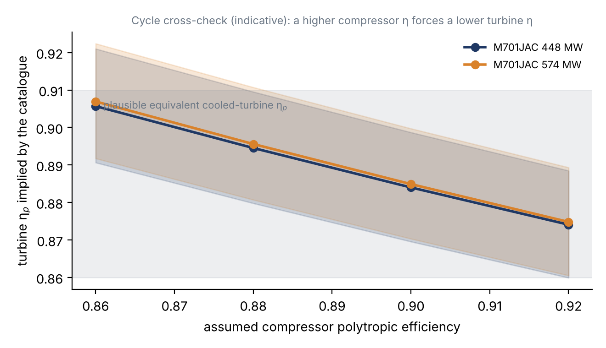
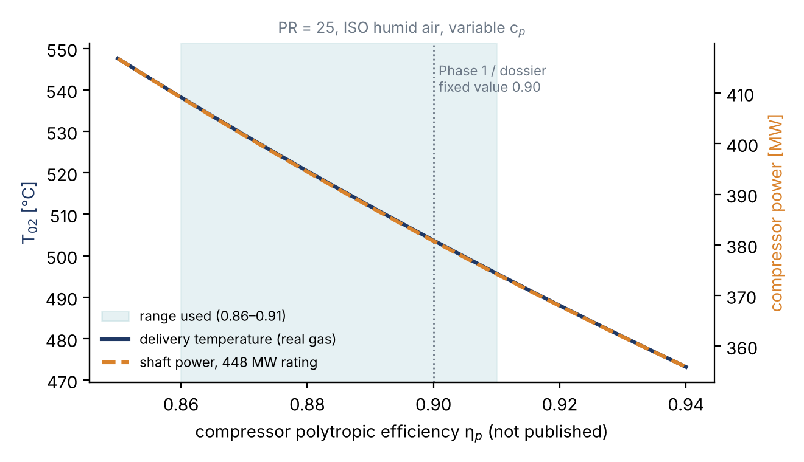
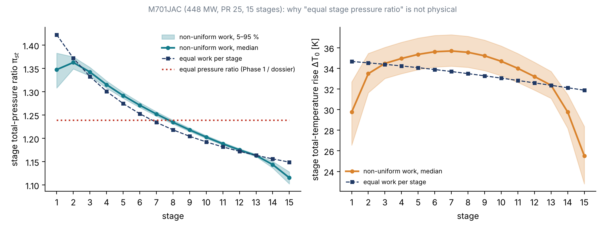

# Assumption Audit — from the Phase 1 estimate to the M701JAC analysis

**Purpose.** The Phase 1 calculations were accepted as reasonable, but the numbers *assumed* to start them were questioned, and two points were raised explicitly by Dr. Montazerin:

1. some assumed efficiencies were too high;
2. equal pressure ratio in every stage is wrong, because the stages carry different loads for specific reasons.

This document lists every number that was assumed rather than taken from a source and explains what has replaced it. It covers the Phase 1 MGT-70(3) estimate (`proposal/source/calc.py`) and the derived values in the team's M701JAC dossier (§5). The new analysis is in `m701jac/analysis/m701jac_analysis.py`, and its generated tables are in `results_tables.md` in the same folder.

**Rule now applied.** Every input is tagged with its origin:

* **CAT** — published in the MHI catalogue (D2);
* **DOC** — stated in an MHI Technical Review (D3–D8);
* **STD** — a physical or ISO standard value;
* **RNG** — not published, so it is carried as a *range* with a stated basis, never as a single number.

Results are reported as a median and a 5–95 % band, so it is visible which results are fixed by data and which are dominated by assumptions. A rank-correlation table in the results shows which assumption drives which result.

---

## 1. The supervisor's two points

### 1.1 Efficiency — "some assumed values are too high"

| | Phase 1 / dossier | Now |
|---|---|---|
| Compressor polytropic efficiency η_p | 0.90, fixed | **range 0.86–0.91** (median ≈ 0.885) |
| Resulting isentropic efficiency at PR 25 | 0.86 (Phase 1, PR 12); the dossier did not state it (≈ 0.85 at PR 25) | **0.83 (0.80–0.86)** |

**Why lower and why a range.** A single "textbook" polytropic efficiency describes a well-designed *stage*. The number needed here is the **whole-machine** value, from the inlet flange to the diffuser exit. That value also carries:

* the inlet bellmouth and the variable IGV;
* the **transonic front stages**, where shock losses are explicitly confirmed by MHI (D6: "reduce the shockwave loss in the initial stages");
* stages 14–15, where the blades are short, so tip clearance is large relative to blade height and the end-wall boundary layers are thick;
* bleed and extraction ports, seal leakages and the exit diffuser.

The value is not published, so a range is the honest representation.

**Cross-check against the catalogue (new).** The catalogue gives the pressure ratio, the heat rate, and the exhaust flow and temperature. For any assumed compressor efficiency, these data fix the delivery temperature, the mixed turbine-inlet enthalpy and the turbine expansion ratio. They therefore imply a turbine efficiency: a higher compressor efficiency must be balanced by a lower turbine efficiency. The model is an equivalent cooled turbine with 0–10 % intermediate-stage bleed, TIT ±50 K, 3–5 % combustor loss and 0–3 % exhaust back-pressure.

| Compressor η_p | 0.86 | 0.88 | 0.90 | 0.92 |
|---|---|---|---|---|
| Implied turbine η_p, median (range) | 0.906 (0.89–0.92) | 0.895 (0.88–0.91) | 0.884 (0.87–0.90) | 0.874 (0.86–0.89) |

The implied turbine efficiencies are realistic for a modern cooled turbine across the adopted range of 0.86–0.91. Values below 0.86 would demand an unrealistically efficient turbine. So the data support the lower range, but they do not pin the value down. This is the most honest statement that can be made without OEM data, and it is a good point to discuss with the supervisor.

**Second effect found during the audit — constant c_p.** Phase 1 and the dossier used c_p = 1004.5–1005 J/kg·K and γ = 1.4. Between 288 K and 790 K, c_p of humid air rises by about 6 %. With real-gas properties (Cantera, humid ISO air) at the same efficiency:

| η_p | T₀₂ perfect gas | T₀₂ real gas | Difference | Specific work, perfect / real |
|---|---|---|---|---|
| 0.885 | 815 K | **789 K** | −26 K | 529 / 525 kJ/kg |
| 0.90 (dossier) | 801 K | **777 K** | −24 K | 515 / 511 kJ/kg |

The perfect-gas model overstates the delivery temperature by about 25 K at PR 25. The power is almost unaffected, because the higher c_p offsets the lower temperature rise.

### 1.2 Stage loading — "equal pressure ratio in all stages is wrong"

Phase 1 (π_st = 12^(1/16) = 1.168 per stage) and dossier Table 6 (π_st = 25^(1/15) = 1.239) both assumed that every stage has the same pressure ratio. This is wrong for two independent reasons.

1. **Even equal work gives unequal pressure ratios.** For a stage with temperature rise ΔT₀ and efficiency η, π_st = (1 + ηΔT₀/T₀,in)^(γ/(γ−1)). Each stage starts hotter than the one before, so the same work produces a smaller pressure ratio. With equal work in the M701JAC, π_st falls from about 1.42 in stage 1 to about 1.15 in stage 15.
2. **The work itself is not equal**, for physical reasons:
   * **Stage 1 is held back**: the transonic tip (estimated M_rel ≈ 1.3, which D6 confirms is transonic), the IGV wakes and inlet distortion, and the start-up rotating-stall and surge-margin requirement that drives the variable IGV and three variable stator rows (D6, D8).
   * **The middle stages carry more**: the flow is subsonic and well matched. The work-done factor (Howell) falls as end-wall boundary layers grow, so the design loading is raised to compensate.
   * **The last stages are unloaded**: short blades, so clearance is large relative to height; thick end-wall boundary layers and blockage; and the exit flow must be close to axial for the diffuser and combustor.
   * **MHI's own description** of the J/JAC compressor is "high-load, high-efficiency" (D3), with a boundary-layer-controlled, high-loading design verified on an eight-stage front-block rig (D7, D8). That is an aerodynamic loading distribution, not a uniform one.

The new model sets stage-1 work at 0.75–0.95 of the mean and the last stage at 0.70–0.90. The middle stages follow a gentle hump that keeps the total equal to the cycle work. The stage efficiencies are 1–4 points lower in stage 1 (shock loss) and 1–3 points lower in the last stage, and the mid-stage efficiency is solved so that the overall PR is exactly 25.

| Stage | Equal PR (old) | Equal work | Non-uniform work (median, 5–95 %) |
|---|---|---|---|
| 1 | 1.239 | 1.42 | **1.35 (1.31–1.38)** |
| 2 | 1.239 | 1.37 | **1.36 (1.35–1.38)** |
| 5 | 1.239 | 1.28 | 1.29 |
| 8 | 1.239 | 1.22 | 1.24 |
| 12 | 1.239 | 1.17 | 1.18 |
| 15 | 1.239 | 1.15 | **1.12 (1.10–1.13)** |

The full stage table, including stage ΔT₀ and exit p₀ and T₀, is in `results_tables.md` §6, and the plots are in `fig_E_stage_distribution.png`. The **shape** of this distribution is still an engineering model, because MHI does not publish the stage-by-stage pressures. It is a defensible starting point for the mean-line design, which will refine it.

---

## 2. Complete list of assumed numbers

| # | Quantity | Phase 1 / dossier value | Problem | Treatment now | Status |
|---|---|---|---|---|---|
| 1 | Compressor polytropic efficiency | 0.90 fixed | Too high for a whole machine (supervisor); one value hides the uncertainty | 0.86–0.91 range plus catalogue cycle cross-check (§1.1) | **Replaced by bounded range** |
| 2 | c_p, γ | 1004.5–1005, 1.4 constant | T₀₂ overstated by ≈ 25 K at PR 25 | Real-gas humid ISO air (Cantera, GRI-Mech 3.0 thermo) | **Replaced by physics** |
| 3 | Stage pressure ratio | Equal in every stage | Physically wrong (supervisor; §1.2) | Non-uniform work distribution with bounded shape factors | **Replaced by model + range** |
| 4 | Fuel-to-air ratio | ≈ 2 % (dossier) | Not derived | Derived from heat rate and LHV: **2.7–3.0 %** (fuel 20.4–22.1 kg/s for 448 MW) | **Replaced by data** |
| 5 | Fuel LHV | 48 MJ/kg (Phase 1) | Fuel composition not stated | 46–50 MJ/kg (pure CH₄ = 50.03 MJ/kg); air flow changes by only ±0.1 % | **Bounded, insensitive** |
| 6 | Inlet air mass flow | exhaust − fuel | Method fine; fuel value was assumed | 743.8 kg/s (743.0–744.6) for 448 MW; 996.4 kg/s for 574 MW | **Data-derived** |
| 7 | Inlet axial velocity | c_x1 = 160 m/s | Arbitrary | Inlet axial Mach 0.45–0.60, constrained by the *transonic front stages* stated in D6 | **Bounded + document constraint** |
| 8 | Inlet hub-to-tip ratio | 0.50 | Arbitrary | 0.40–0.55; it controls M_rel,tip (rank correlation +0.95) | **Bounded; key unknown** |
| 9 | Exit axial velocity and mean radius | c_x = 130 m/s, constant mean radius | Arbitrary; constant mean radius is not known | Exit Mach 0.25–0.35; only the exit *area* is reported (no radius assumed) | **Bounded** |
| 10 | Inlet pre-swirl | None (IGV open at design) | IGV angle not published | Kept, flagged; reduces M_rel,tip if the IGV is closed | **Remaining assumption** |
| 11 | Blade material density | Steel, 7800 kg/m³ | Material not published | Kept, flagged (titanium would cut the stress by ≈ 42 %) | **Remaining assumption** |
| 12 | Blade taper factor | K = 2/3 | Arbitrary | 0.55–0.70 | **Bounded** |
| 13 | Mean-stage velocity triangles | φ = 0.55–0.59, ψ = 0.30–0.35, R = 0.5 (Phase 1, video) | Derived from equal-stage, constant-radius assumptions | Not used for M701JAC yet; ψ at the inlet mean radius is shown only as an indicator. Triangles come from the mean-line design in Phase 2 | **Deferred to mean-line design** |
| 14 | Bleed and cooling extraction | Neglected | Cooling air is extracted at intermediate stages (D2) | Compressor power is reported as a full-delivery **upper bound**; the cross-check gives a 7–22 % bypass fraction | **Bounded, indicative** |
| 15 | Generator and mechanical losses | Neglected | Small, but they enter the back-work ratio | Closed by the energy-balance residual (+0.8 to +1.7 % of heat input) | **Data-checked** |
| 16 | Inlet / exhaust pressure losses | None | ISO ratings are at generator terminals; losses not stated | Exhaust back-pressure 0–3 % in the cross-check; inlet losses still neglected | **Partly bounded** |

---

## 3. What is now fixed by data, and what is not

**Fixed by the catalogue to within about 0.3 %:**

* inlet air flow;
* fuel flow;
* heat input;
* the energy balance (closes to +1.1 % for the 448 MW rating).

**Dominated by one unpublished input each:**

* delivery temperature and compressor power — the efficiency;
* first-rotor tip diameter — inlet axial Mach and hub-to-tip ratio;
* relative tip Mach — mainly the hub-to-tip ratio;
* exit annulus area — exit Mach.

These are the quantities on which the reverse engineering should concentrate any further documentary evidence: photographs (the M701J rotor photo), cross-section drawings, and papers on the J-series compressor.

## 4. Open questions for the team and the supervisor

1. **Which rating is the target?** The catalogue lists two M701JAC ratings: 448 MW with PR 25 and 765 kg/s, and 574 MW with PR > 25 and 1,024 kg/s. The Thailand units (D3) deliver 662–700 MW net combined cycle each. That is above the 650 MW rating of the 448 MW gas turbine, so the fleet in service is most likely the larger machine. This analysis runs both ratings.
2. **The 60 Hz → 50 Hz scaling rule does not reproduce the catalogue flows.** A 1.2× scale of the current M501JAC (815 kg/s) would pass 1,174 kg/s at 3000 rpm. The two M701JAC ratings correspond to linear scales of 0.97 and 1.12. The documented rule (D5) holds for the J series (M701J/M501J output ratio 680/470 = 1.45), but it should **not** be used to derive M701JAC geometry from M501JAC data without a source.
3. Is the efficiency range of 0.86–0.91 acceptable to the supervisor, given the cycle cross-check?
