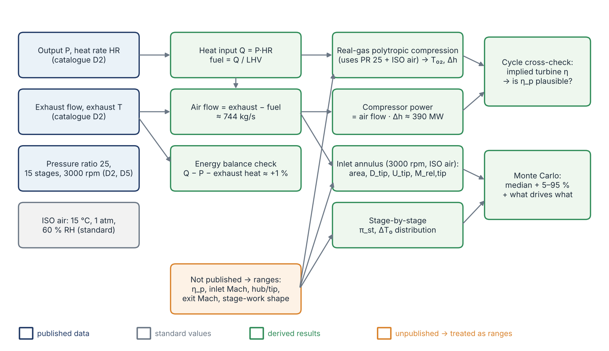
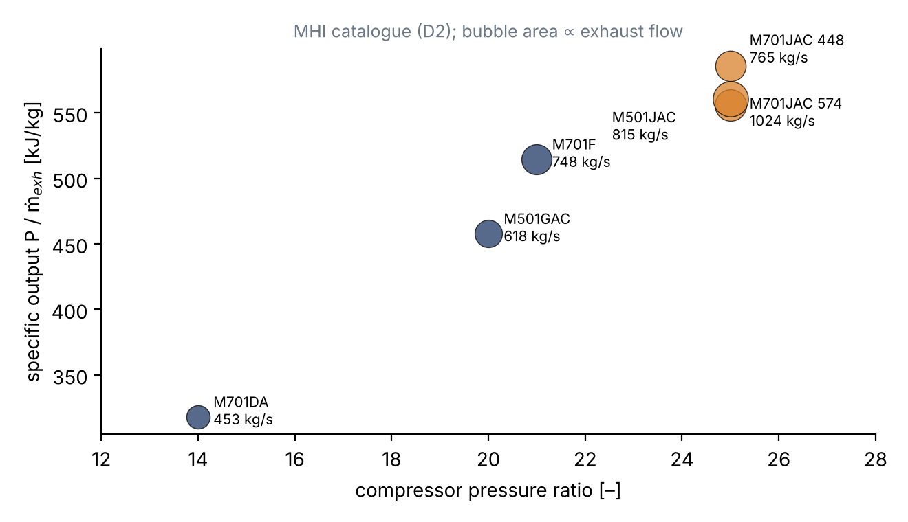
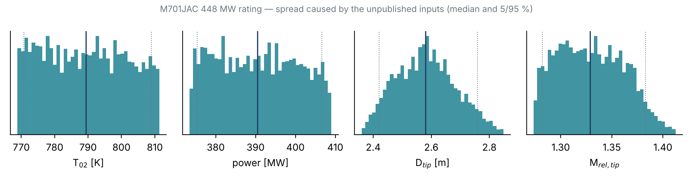

::: {custom-style="Cover Institution"}
Amirkabir University of Technology (Tehran Polytechnic)
:::

::: {custom-style="Cover Course"}
Department of Mechanical Engineering · Turbomachinery Course Project
:::

::: {custom-style="Cover Title"}
The M701JAC Axial Compressor: What We Know, What We Derived, and What Is Still Open
:::

::: {custom-style="Cover Subtitle"}
Internal study report — for the team's own reading and learning
:::

::: {custom-style="Cover Target"}
Not an official submission. It prepares the ground for the 15 Aban 1405 report, which is not drafted yet.
:::

::: {custom-style="Cover Meta"}
**Team:** Alireza Bayati  ·  Melika Bali

**Supervisor:** Dr. Nader Montazerin

**Date:** 6 Aban 1405 (28 October 2026)

**Companion files:** `m701jac/analysis/` (code, results, figures) · `m701jac/docs/ASSUMPTIONS_AUDIT.md` · `m701jac/docs/DOSSIER_REVIEW.md`
:::

::: {custom-style="Cover Note"}
Prepared with the assistance of Claude (Anthropic). Every number in this report is either taken from a cited Mitsubishi document, a physical standard value, or derived from those. Anything that is not published is carried as a stated range, never as a single guessed value.
:::

```{=openxml}
<w:p><w:r><w:br w:type="page"/></w:r></w:p>
<w:p><w:pPr><w:pStyle w:val="TOCHeading"/></w:pPr><w:r><w:t>Table of Contents</w:t></w:r></w:p>
<w:p><w:r><w:fldChar w:fldCharType="begin" w:dirty="true"/></w:r><w:r><w:instrText xml:space="preserve"> TOC \o "1-2" \h \z \u </w:instrText></w:r><w:r><w:fldChar w:fldCharType="separate"/></w:r><w:r><w:t>[The table of contents is generated by Word: if it is not shown, right-click here and choose “Update Field”.]</w:t></w:r><w:r><w:fldChar w:fldCharType="end"/></w:r></w:p>
<w:p><w:r><w:br w:type="page"/></w:r></w:p>
```

# How to read this report {.unnumbered}

This report has two purposes. First, it records what has been done so far on the new machine, so that both of us know the reasoning behind every number before the 15 Aban report is written. Second, it is meant to *teach*: each result comes with the physics that explains it, so that we can defend it in an oral discussion. Two kinds of side notes appear throughout:

* **Learning note** — the turbomachinery idea behind a result (with the textbook section to read).
* **Caution** — a place where a number is weaker than it looks, or where we found a mistake.

Every input carries a tag: **[CAT]** published in the Mitsubishi GTCC catalogue (D2), **[DOC]** stated in an MHI Technical Review (D3–D8), **[STD]** a physical or ISO standard value, **[RNG]** not published and therefore carried as a range. The document list is at the end of the report.

# Why the M701JAC

After the Phase 1 submission we moved from the MAPNA MGT-70(3) (a 1990s-design, V94.2-class machine with pressure ratio 12) to the **Mitsubishi Power M701JAC**, the 50 Hz member of the J-series and one of the most efficient gas turbines in service. It is a better study object for three reasons:

1. **It is modern.** Its compressor reaches a pressure ratio of 25 in only 15 stages, with transonic front stages, a "high-load" design and four rows of variable vanes. It shows the current state of the art rather than the 1990s one.
2. **It is unusually well documented for a commercial machine.** MHI publishes a full ISO rating table, and its Technical Review papers describe the compressor's design concept, verification tests and development history (D2–D8).
3. **It is in wide service.** Ten M701JAC units (6,700 MW) have operated in Thailand since 2021, with 140,000 operating hours [DOC D3]. The J-series fleet has more than 3 million operating hours [CAT D2].

The price of choosing a modern machine is that the information we most need, the blade geometry, is proprietary. The whole method in this report is built around that fact.

# What Mitsubishi publishes about the machine

## The family history in one table

The JAC is the latest step in a line of large-frame designs. Knowing the line explains many design choices, because each generation reused the previous compressor technology.

| Model | Freq. / speed | Compressor | PR | GT output | Source |
|:----------|:-----------|:-----------------|:-----|:-----------|:-----------------|
| M501G | 60 Hz / 3600 rpm | 17 stages | 20 | 267 MW | [DOC D6] |
| H-series | — | (compressor verified at T-Point, 2001) | 25 | — | [DOC D4, D6] |
| M501J | 60 Hz / 3600 rpm | 15 stages, based on the H-series compressor | 23 | 327–330 MW | [DOC D5, D6, D4] |
| M701J | 50 Hz / 3000 rpm | 15 stages; 1.2× geometric scale of the M501J | 23 | GTCC 680 MW | [DOC D5] |
| M501JAC | 60 Hz / 3600 rpm | same flow-path shape as J; PR raised | 25 / > 25 | 425–453 MW | [DOC D4], [CAT D2] |
| **M701JAC** | **50 Hz / 3000 rpm** | **15 stages, J-series compressor** | **25 / > 25** | **448 / 574 MW** | [CAT D2] |

Table: Table 1. Evolution of the Mitsubishi large-frame compressor.

> **Learning note — the 1.2× scaling rule.** The 50 Hz M701J was made by multiplying every dimension of the 60 Hz M501J by 3600/3000 = 1.2 [DOC D5]. Because the blade speed $U=\omega r$ is then unchanged, all velocity triangles, Mach numbers, stresses and temperatures are unchanged too; only the flow area (and therefore mass flow and power) grows by $1.2^2 = 1.44$. This is turbomachinery similarity in its purest form (Dixon & Hall, Ch. 2). We will see in Section 9 that the *current* M701JAC ratings do not follow this rule exactly.

## The catalogue ratings

Mitsubishi lists two ISO ratings for the M701JAC [CAT D2]:

| Parameter | 448 MW rating | 574 MW rating |
|:------------------------------|:------------:|:------------:|
| ISO base output (generator terminals) | 448 MW | 574 MW |
| Efficiency (LHV) / heat rate | 44.0 % / 8182 kJ/kWh | 43.4 % / 8295 kJ/kWh |
| Compressor pressure ratio | 25 | > 25 |
| Exhaust flow / temperature | 765 kg/s / 663 °C | 1024 kg/s / 646 °C |
| Speed | 3000 rpm | 3000 rpm |
| Combined cycle (1-on-1) | 650 MW, > 64 % | 840 MW, > 64 % |

Table: Table 2. M701JAC ISO ratings (101.3 kPa, 15 °C, 60 % RH, natural gas).

## What is published about the compressor

* Axial, 15 stages (J-series flow path), 3-D blading [CAT D2; DOC D5, D6].
* Variable inlet guide vanes plus variable stator vanes on the **first three stages**; the four rows act together to modulate air flow, which keeps the exhaust temperature high at part load for the steam cycle [CAT D2; DOC D6].
* Advanced 3-D design to reduce **shock-wave loss in the initial stages** and **frictional loss in the intermediate and final stages**, which tells us the front stages are **transonic** [DOC D6].
* Start-up bleeds from low-, middle- and high-pressure stages; rotating stall disappears at about **60 % speed**; blade vibration stresses and natural frequencies were measured on the first engine [DOC D6].
* For the JAC, the pressure ratio was raised from 23 to 25 to limit the exhaust temperature rise caused by the higher turbine inlet temperature (1650 °C class). A high-PR compressor has a relatively smaller outlet area, raising concern about rotating stall at start-up; a PR-25 J-based compressor was verified at T-Point in May 2018 [DOC D4].
* MHI calls it a "high-load, high-efficiency compressor" [DOC D3]; the related research compressor is boundary-layer-controlled and was tested as an eight-stage front block with variable vanes, including surge tests [DOC D7, D8].
* Turbine cooling air: row-1 vanes use compressor discharge air; the other vane rows use intermediate-stage bleeds; an enhanced air-cooling system extracts air at the compressor outlet, cools it externally, re-pressurises it and returns it to the combustor [CAT D2; DOC D4].

## What is not published

Annulus radii, blade counts, chords, stagger and metal angles, stage-by-stage pressures, the compressor map and IGV schedule, bleed flows, the compressor efficiency, blade materials and Campbell diagrams. **Every one of these is what a reverse engineering must reconstruct.**

# Method: from a catalogue to compressor numbers

## The calculation chain

Figure 1 shows how the published numbers are turned into compressor quantities. The key idea is that some results are *fixed by data* (they barely move whatever we assume), while others are *dominated by one unpublished input*. Knowing which is which tells us where to spend effort.

{width=100%}

## Step 1 — air flow from the heat rate

The heat rate gives the fuel heat input directly, and the fuel mass flow follows from the lower heating value:

$$ \dot Q=P\cdot HR,\qquad \dot m_f=\frac{\dot Q}{LHV},\qquad \dot m_a=\dot m_{exh}-\dot m_f $$

For the 448 MW rating: $\dot Q = 448\ \text{MW}\times 8182\ \text{kJ/kWh}/3600 = 1018$ MW. Pure methane (LHV = 50.03 MJ/kg at 15 °C, computed) gives $\dot m_f = 20.4$ kg/s and $\dot m_a = 744.6$ kg/s. The fuel composition is not stated, so the LHV is carried as 46–50 MJ/kg [RNG]; this moves the air flow by only ±0.1 %.

> **Caution.** The dossier used "about 2 % fuel". The heat rate says 2.7–3.0 %. Small, but it is the kind of guessed number the supervisor asked us to remove.

## Step 2 — real-gas compression

The compressor delivery temperature follows from the pressure ratio and the polytropic efficiency. For an ideal gas with *variable* $c_p(T)$ the exact polytropic relation is

$$ \int_{T_{01}}^{T_{02}}\frac{c_p(T)}{T}\,dT=\frac{R}{\eta_p}\ln\pi_c $$

which reduces to the familiar $T_{02}/T_{01}=\pi_c^{(\gamma-1)/(\gamma\eta_p)}$ only if $c_p$ is constant. We solve it with Cantera (GRI-Mech 3.0 species data) for humid ISO air (60 % relative humidity, about 1 % water vapour by moles). The specific work is $\Delta h_0 = h(T_{02})-h(T_{01})$ and the shaft power is $\dot W_c=\dot m_a\,\Delta h_0$.

> **Learning note — polytropic vs isentropic efficiency.** The isentropic efficiency compares the whole machine with one ideal process from 1 to 25 bar. The polytropic efficiency is the efficiency of each *small* compression step. Because a loss in an early stage heats the air and makes every later stage work harder (the *preheat* or reheat effect), $\eta_c<\eta_p$ for a compressor, and the gap grows with pressure ratio. At PR 25 and $\eta_p=0.885$ we get $\eta_c\approx0.83$ (Dixon & Hall §2.6; Saravanamuttoo §2.2).

## Step 3 — inlet annulus and the first rotor

For a given inlet axial Mach number $M_x$ the static state, density and axial velocity follow from the total state; the annulus area is then $A=\dot m_a/(\rho_1 c_x)$. With a hub-to-tip ratio $\nu=r_h/r_t$:

$$ r_t=\sqrt{\frac{A}{\pi(1-\nu^2)}},\qquad U_t=\omega r_t,\qquad M_{1,rel,tip}=\frac{\sqrt{c_x^2+U_t^2}}{a_1} $$

(no pre-swirl, i.e. IGV open at full load). The root centrifugal stress of the first rotor blade is estimated from

$$ \sigma_{root}=K\,\rho_b\,\omega^2\,\frac{A}{2\pi} $$

with a taper factor $K$ = 0.55–0.70.

## Step 4 — uncertainty as ranges, not guesses

Each unpublished input is given a range with a stated basis (Table 3). The analysis draws 4,000 random combinations (a Monte Carlo sample), evaluates everything for each, and reports the **median** and the **5–95 % band**. It also reports a rank correlation between every input and every output, which shows directly *which assumption controls which result*.

| Input [RNG] | Range | Basis |
|:------------------------------|:-------------|:------------------------------------------------|
| Compressor polytropic efficiency $\eta_p$ | 0.86–0.91 | whole-machine value incl. transonic front stages, bleeds, clearances; lowered after the supervisor's comment |
| Fuel LHV | 46–50 MJ/kg | natural gas, composition not stated |
| Inlet axial Mach $M_x$ | 0.45–0.60 | large industrial compressors |
| Inlet hub-to-tip ratio $\nu$ | 0.40–0.55 | heavy-duty first stages |
| Exit axial Mach | 0.25–0.35 | compressor exit ahead of the diffuser |
| Blade taper factor $K$ | 0.55–0.70 | tapered blades (1.0 = constant section) |
| Stage-work shape (Section 7) | stage 1: 0.75–0.95 × mean; last stage: 0.70–0.90 × mean | physical reasons in Section 7 |

Table: Table 3. Unpublished inputs and their ranges.

# Result 1 — the catalogue is self-consistent

Before using published numbers to derive anything, we checked that they agree with each other. The energy entering the gas turbine as fuel must leave as electricity, as exhaust heat, or as small losses:

$$ \dot Q - P - \dot m_{exh}\left[h_{exh}(T_{exh})-h_{exh}(T_{ref})\right]=\text{residual},\qquad T_{ref}=288.15\ \text{K} $$

| Rating | Heat input | Exhaust heat | Residual |
|:--------|:--------:|:--------:|:--------:|
| 448 MW | 1018 MW | 559 MW | +10.8 MW (+1.1 %) |
| 574 MW | 1323 MW | 726 MW | +22.2 MW (+1.7 %) |

Table: Table 4. Overall energy balance (methane fuel, real-gas exhaust properties).

A residual of about 1 % is exactly what should remain: generator and mechanical losses (≈ 1–1.5 % of output), casing heat loss, and the heat removed by the external cooler of the enhanced air-cooling system. **The catalogue numbers can be trusted**, and the inlet air flow (743.8 kg/s, band 743.0–744.6) is effectively fixed by data.

# Result 2 — compressor thermodynamics

| Quantity (448 MW rating) | Median | 5–95 % band | Controlled by |
|:-----------------------------|:------:|:------:|:-------------|
| Inlet air flow | 743.8 kg/s | 743.0–744.6 | data (LHV only) |
| Delivery total temperature $T_{02}$ | 789 K (516 °C) | 771–809 K | $\eta_p$ |
| Isentropic efficiency $\eta_c$ | 0.828 | 0.795–0.862 | $\eta_p$ |
| Specific work $\Delta h_0$ | 525 kJ/kg | 505–547 kJ/kg | $\eta_p$ |
| Shaft power (full delivery flow) | 390 MW | 375–407 MW | $\eta_p$ |
| Mean stage $\Delta T_0$ | 33.4 K | 32.2–34.7 K | $\eta_p$ |

Table: Table 5. Thermodynamic results (median and 5–95 % band).

{width=78%}

**The compressor absorbs almost as much power as the machine delivers.** With about 390 MW for compression and about 455 MW at the shaft (448 MW at the terminals divided by an assumed generator efficiency of about 98.5 %), the turbine must produce roughly 845 MW, so about **46 % of the turbine's work goes back into the compressor**. This *back-work ratio* is why a one-point gain in compressor efficiency is so valuable, and why MHI invests so heavily in the compressor.

> **Learning note — real gas vs. constant $c_p$.** Phase 1 and the dossier used $c_p$ = 1005 J/kg·K and $\gamma$ = 1.4. Between 288 K and 790 K, $c_p$ of air rises by about 6 %, so a given amount of work produces a *smaller* temperature rise. At $\eta_p$ = 0.885 the constant-$c_p$ model gives 815 K, the real-gas model 789 K: **26 K too high**. The power hardly changes (529 vs 525 kJ/kg) because the larger $c_p$ compensates. Lesson: temperatures at high pressure ratio need variable properties; work estimates are more forgiving.

# Result 3 — how efficient is the compressor?

The supervisor's first comment was that our assumed efficiencies were too high. The compressor efficiency is not published, so we cannot simply look it up. But the catalogue does constrain it *indirectly*, through the turbine.

**The idea.** For any assumed compressor efficiency, we know the delivery enthalpy (Section 5), the fuel heat input (Section 4), the turbine pressure ratio (from PR 25 minus combustor and exhaust losses) and the exhaust temperature (663 °C, catalogue). Mixing everything that enters the turbine gives its inlet state; the expansion must end exactly at the catalogue exhaust temperature. That fixes the turbine efficiency the data *imply*. A more efficient compressor delivers cooler air, the turbine starts cooler, and to reach the same exhaust temperature over the same pressure ratio it must be *less* efficient. The two efficiencies are coupled by the data.

| Assumed compressor η_p | 0.86 | 0.88 | 0.90 | 0.92 |
|:--------------------------|:----:|:----:|:----:|:----:|
| Delivery temperature | 811 K | 794 K | 777 K | 761 K |
| Implied turbine $\eta_p$ (median, range) | 0.906 (0.89–0.92) | 0.895 (0.88–0.91) | 0.884 (0.87–0.90) | 0.874 (0.86–0.89) |
| Air bypassing the combustor | 7–16 % | 8–17 % | 9–18 % | 11–19 % |

Table: Table 6. Cycle cross-check (448 MW rating; ranges over turbine inlet temperature ±50 K, combustor loss 3–5 %, exhaust back-pressure 0–3 %, intermediate bleed 0–10 %).

{width=78%}

**What this tells us.** Across our adopted range (0.86–0.91) the implied turbine efficiencies are realistic. A compressor below about 0.86 would need a turbine above 0.92, which is very unlikely for a cooled first stage. So the data support the lower range the supervisor asked for, without proving any single value. That is the honest answer, and a good point to discuss with him.

> **Caution — the model is simplified.** All cooling air is treated as mixing before an "equivalent uncooled" turbine, and bleed is approximated as leaving at half the compression work. The bypass fraction (7–19 %) is lower than the 20–25 % often quoted for 1600 °C-class engines, which may mean MHI's "turbine inlet temperature" is defined differently from our combustor-exit value. Treat Table 6 as a plausibility check, not a measurement.

> **Caution — a mistake we caught.** The first version of the compression code integrated $dh = v\,dp/\eta_p$ with a simple explicit step. That overstated the delivery temperature by 10–15 K, and for a while made the turbine look implausibly efficient. Replacing it with the exact relation of Section 3.3 removed the error. Lesson: check numerical integration against a closed-form case before trusting it.

# Result 4 — stage loading is not uniform

The supervisor's second comment was that **equal pressure ratio in every stage is wrong**. He is right, and for two separate reasons.

## Reason 1: equal work already gives unequal pressure ratios

The pressure ratio a stage produces from a temperature rise $\Delta T_0$ depends on the temperature at which it starts:

$$ \pi_{st}=\left[1+\frac{\eta_{st}\,\Delta T_0}{T_{0,in}}\right]^{\frac{\gamma}{\gamma-1}} $$

In the M701JAC, stage 1 starts at 288 K and stage 15 at about 760 K. The same $\Delta T_0$ therefore buys a much larger pressure ratio at the front. With *equal work* in all 15 stages, $\pi_{st}$ falls from about 1.42 in stage 1 to about 1.15 in stage 15. Assuming 1.239 everywhere (= $25^{1/15}$) contradicts even the simplest loading.

## Reason 2: the stages do not do equal work

| Where | Loading | Why |
|:----------|:---------------|:-------------------------------------------------------|
| Stage 1 | **reduced** (0.75–0.95 × mean) | Transonic tip (estimated $M_{rel}\approx1.3$; shock losses confirmed by D6); IGV wakes and inlet distortion; start-up rotating stall and surge margin (the reason for the variable IGV and three variable stator rows, D6, D8) |
| Stages 2–13 | **raised** (slight hump above the mean) | Subsonic, well-matched flow; the work-done factor falls as end-wall boundary layers thicken, so the design loading is raised to keep delivering the required work |
| Stages 14–15 | **reduced** (0.70–0.90 × mean) | Short blades, so tip clearance is large relative to blade height; thick end-wall boundary layers and blockage; the exit flow must be close to axial for the diffuser and combustor |

Table: Table 7. Why the stage work varies along the compressor.

> **Learning note — the work-done factor.** In a multistage compressor the axial velocity is not uniform across the span: the end-wall boundary layers grow stage after stage, and the blades near the walls do less useful work than the mean-line triangles suggest. Howell's *work-done factor* $\lambda$ captures this, $\Delta h_0=\lambda\,U\,\Delta c_\theta$, falling from about 0.98 in the first stages to about 0.85 in later stages (Saravanamuttoo §5.4; Dixon & Hall §5.11). Designers compensate by loading the rear-middle stages a little more.

## The resulting stage distribution

The model reproduces PR 25 exactly. Stage-1 efficiency is 1–4 points lower (shock loss) and the last stage 1–3 points lower; the middle-stage efficiency is solved so that the overall pressure ratio is met.

| Stage | Equal PR (old) | Equal work | Non-uniform work: stage PR | ΔT₀ [K] | Exit p₀ [bar] |
|:---:|:----:|:----:|:----------------:|:-------:|:-----:|
| 1 | 1.239 | 1.422 | 1.35 (1.31–1.38) | 29.8 | 1.37 |
| 2 | 1.239 | 1.372 | 1.36 (1.35–1.38) | 33.5 | 1.86 |
| 3 | 1.239 | 1.333 | 1.34 (1.33–1.35) | 34.5 | 2.50 |
| 5 | 1.239 | 1.275 | 1.29 (1.29–1.30) | 35.4 | 4.24 |
| 8 | 1.239 | 1.218 | 1.24 (1.23–1.24) | 35.6 | 8.33 |
| 10 | 1.239 | 1.192 | 1.20 (1.20–1.21) | 34.7 | 12.21 |
| 12 | 1.239 | 1.172 | 1.18 (1.17–1.18) | 33.2 | 17.06 |
| 14 | 1.239 | 1.156 | 1.14 (1.14–1.15) | 29.8 | 22.71 |
| 15 | 1.239 | 1.149 | 1.12 (1.10–1.13) | 25.5 | 25.33 |

Table: Table 8. Stage-by-stage distribution, 448 MW rating (selected stages; full table in Appendix A).

{width=100%}

> **Caution.** The *shape* of the work distribution is an engineering model with ranges, because MHI does not publish stage pressures. It is a defensible starting point; the mean-line design in Phase 2 must refine it stage by stage.

# Result 5 — the first rotor: a transonic stage

| Quantity (448 MW rating) | Median | 5–95 % band | Controlled by |
|:-----------------------------|:------:|:------:|:-------------|
| Inlet annulus area | 4.01 m² | 3.69–4.42 m² | inlet Mach |
| First-rotor tip diameter | 2.58 m | 2.42–2.76 m | inlet Mach, hub/tip ratio |
| First-rotor hub diameter | 1.23 m | 1.01–1.47 m | hub/tip ratio |
| Tip speed | 405 m/s | 380–433 m/s | hub/tip ratio |
| Relative tip Mach number | 1.33 | 1.28–1.38 | hub/tip ratio |
| Root centrifugal stress (steel) | 307 MPa | 264–357 MPa | taper, inlet Mach |
| Exit annulus area; $A_{out}/A_{in}$ | 0.42 m²; 0.105 | 0.37–0.49 m²; 0.089–0.126 | exit Mach |

Table: Table 9. First-rotor and annulus results (median and 5–95 % band).

{width=82%}

**Interpretation.** At 3000 rpm and 744 kg/s, every plausible combination gives a first-rotor tip that is **supersonic relative to the blade** ($M_{rel}$ 1.28–1.38). This is independent evidence that our ranges are sensible, because MHI explicitly says it had to reduce shock-wave losses in the initial stages [DOC D6]. The relative Mach number is controlled almost entirely by the hub-to-tip ratio: a larger hub means a larger tip radius for the same area, hence a higher tip speed.

The exit area is only about one tenth of the inlet area. The air is about 9 times denser at exit (25 times the pressure, 2.7 times the absolute temperature), and this matches MHI's remark that the high-PR compressor has a "relatively reduced outlet flow area" [DOC D4]. It also explains why the rear blades are so short.

> **Learning note — why the first stage is the mechanically critical one.** The root stress scales with $\rho_b\,\omega^2 A$ (often written $AN^2$), and $A$ is largest at the inlet. The first rotor also sees the strongest aerodynamic excitation (IGV wakes, inlet distortion) and the rotating-stall cells at start-up. That is why MHI measured blade and vane vibration stress on the first engine [DOC D6]. Our 307 MPa is a first estimate for a steel blade; the blade material is not published and must be compared with real material data (and the Campbell diagram) in Phase 2.

# Result 6 — two ratings and a scaling puzzle

The catalogue lists two M701JAC ratings, and they are not two operating points of one machine: the flows differ by 34 %.

| Model | Speed | PR | Output | Exhaust flow | Specific output |
|:------------|:------:|:----:|:------:|:------:|:------:|
| M701F | 3000 | 21 | 385 MW | 748 kg/s | 515 kJ/kg |
| M501JAC | 3600 | 25 | 453 MW | 815 kg/s | 556 kJ/kg |
| M701JAC (448) | 3000 | 25 | 448 MW | 765 kg/s | 586 kJ/kg |
| M701JAC (574) | 3000 | 25 | 574 MW | 1024 kg/s | 561 kJ/kg |

Table: Table 10. MHI catalogue machines compared (D2).

{width=78%}

**The puzzle.** If the M701JAC were a 1.2× scale of today's M501JAC (815 kg/s), it would pass 815 × 1.44 = **1,174 kg/s**. The two published ratings correspond to linear scales of only 0.97 and 1.12. The 1.2× rule is documented for the J series (D5), but the present JAC ratings clearly do not follow it exactly. We must therefore **not** derive M701JAC geometry by scaling M501JAC data.

**Which rating is in service?** The Thailand plants deliver 662–700 MW net per single-shaft unit [DOC D3], above the 650 MW combined-cycle rating of the 448 MW machine (and Thailand is hotter than ISO, which lowers output). The fleet in service is therefore most likely the larger, 574 MW-class machine. **We need to choose our target rating** before the mean-line design. Everything in this report is computed for both; the tables show the 448 MW rating because its pressure ratio is stated exactly (25, not "> 25").

# What drives what: sensitivity

| Result | Controlled mainly by | Rank correlation |
|:----------------------|:---------------------------|:-----------:|
| Inlet air flow | fuel LHV (tiny effect) | +1.00 |
| Delivery temperature, power | compressor efficiency $\eta_p$ | −1.00 |
| First-rotor tip diameter | inlet Mach (−0.73) and hub/tip ratio (+0.67) | — |
| Relative tip Mach number | hub/tip ratio | +0.95 |
| Exit/inlet area ratio | exit Mach (−0.83), inlet Mach (+0.53) | — |
| Root stress | taper factor (+0.77), inlet Mach (−0.63) | — |

Table: Table 11. Which unpublished input controls which result (Spearman rank correlation, 448 MW rating).

{width=100%}

This table is the most useful planning tool we have. **Any new evidence about the hub-to-tip ratio or the inlet annulus** (a cross-section drawing, a measured photograph of the rotor, a paper giving the first-stage tip speed) will tighten the geometry far more than anything else. **Any evidence about efficiency** (a published compressor map, test data) will tighten the thermodynamics.

# How the AI was used, and where it went wrong

Since this project is also a study of AI, it is worth recording honestly what happened in this phase.

* **What worked well.** Reading and cross-checking eight technical documents in minutes; finding that the dossier's scaling statement contradicts the catalogue; building a real-gas, uncertainty-aware analysis that runs in seconds; turning the supervisor's two comments into concrete models.
* **Errors the AI made and corrected.** (1) A numerical-integration error in the first version of the compression code (Section 6). (2) A first efficiency range of 0.89–0.93 that was *higher* than the Phase 1 value. It was lowered once the supervisor's comment arrived. (3) In Phase 1, the constant-$c_p$ and equal-stage-ratio simplifications were used without warning how much they matter.
* **What the AI could not do.** It could not open the groupmate's shared chat link (it requires a login). It cannot see blade geometry that is not published. Every geometric number in this report is therefore a range, not a reconstruction.
* **Lesson for us.** The AI is fast at the mechanics and good at cross-checking sources, but its *assumptions* need the same scrutiny the supervisor applied. The ranges-and-sensitivity approach makes that scrutiny possible.

# Preparing for the 15 Aban report

The 15 Aban report asks for the reverse engineering "with fluid, thermodynamic, vibration and mechanical calculations". This report covers the thermodynamic frame and the first-stage sizing. Still to do:

1. **Decide the target rating** (448 MW or 574 MW; Section 9).
2. **Choose the annulus shape** (constant tip, constant mean or constant hub radius, or a blend) and use it to fix the radius at every stage. This is the single biggest missing piece.
3. **Mean-line design, stage by stage:** blade speed at each stage, velocity triangles from the work distribution of Section 7, degree of reaction, de Haller and diffusion-factor checks, and blade counts and chords from the diffusion-factor limits.
4. **Radial variation:** free-vortex or controlled-vortex twist for the long front blades.
5. **Mechanical:** root stress of every rotor row with a stated material; disc stress for the first stage.
6. **Vibration:** first natural frequencies of the front blades against 50 Hz engine orders and blade-passing frequencies, summarised on a Campbell diagram.
7. **Off-design and stability:** the role of the IGV and three variable stator rows, and the 60 % speed rotating-stall observation (D6).

**Evidence that would help most:** a cross-section drawing of the J-series compressor, measurements from the M701J rotor photograph, the D1 product-page text, and any paper giving stage-level data.

**Questions for the supervisor:** Is the efficiency range 0.86–0.91 acceptable, given the cycle cross-check? Which rating should we target? Is the non-uniform work distribution of Section 7 an acceptable starting point for the mean-line design?

# Sources {.unnumbered}

::: {custom-style="Reference"}
[D1] Mitsubishi Power, "M701J/JAC Series," product page (figures: correction curves, plant layouts, rotor photograph). https://power.mhi.com/products/gasturbines/lineup/m701j

[D2] Mitsubishi Power, *GTCC Gas Turbine Combined Cycle Power Plants*, catalogue, 2026. https://power.mhi.com/catalogue/pdf/gtcc.pdf

[D3] Y. Takashima et al., "Successful 10 Units Completion of M701JAC Gas Turbine Combined Cycle in Thailand," *MHI Technical Review* 62(3), 2025.

[D4] K. Takamura et al., "Development of 1650°C Class Next Generation JAC Gas Turbine based on J Experience," *MHI Technical Review* 56(3), 2019.

[D5] S. Hada et al., "High-efficiency Gas Turbine Development applying 1600°C class 'J' Technology," *MHI Technical Review* 52(2), 2015.

[D6] S. Hada et al., "Test Results of the World's First 1,600°C J-series Gas Turbine," *MHI Technical Review* 49(1), 2012.

[D7] E. Ito et al., "Key Technologies for Ultra-High Temperature Gas Turbines," *MHI Technical Review* 52(2), 2015.

[D8] K. Ishizaka et al., "Key Technologies for 1700°C Class Ultra High Temperature Gas Turbine," *MHI Technical Review* 54(3), 2017.

[T1] S. L. Dixon and C. A. Hall, *Fluid Mechanics and Thermodynamics of Turbomachinery*, 7th ed. Butterworth-Heinemann, 2014.

[T2] H. I. H. Saravanamuttoo et al., *Gas Turbine Theory*, 7th ed. Pearson, 2017.

[T3] N. Montazerin, *Turbomachines: Basic Design and Application* (in Persian). Amirkabir University of Technology Press, 1999.

[T4] D. G. Goodwin et al., *Cantera: An object-oriented software toolkit for chemical kinetics, thermodynamics, and transport processes*, version 3.2. https://www.cantera.org
:::

# Appendix A — Full stage table (448 MW rating) {.unnumbered}

| Stage | Stage PR, median (5–95 %) | ΔT₀ [K] | Exit T₀ [K] | Exit p₀ [bar] |
|:---:|:---------------:|:-----------:|:--------:|:---------:|
| 1 | 1.348 (1.308–1.383) | 29.8 (26.6–32.7) | 318 (315–321) | 1.37 (1.33–1.40) |
| 2 | 1.363 (1.349–1.375) | 33.5 (31.6–35.5) | 351 (346–356) | 1.86 (1.79–1.93) |
| 3 | 1.342 (1.334–1.352) | 34.5 (33.0–36.0) | 386 (380–392) | 2.50 (2.41–2.57) |
| 4 | 1.315 (1.308–1.323) | 35.0 (33.5–36.5) | 421 (415–428) | 3.28 (3.19–3.38) |
| 5 | 1.292 (1.286–1.299) | 35.4 (33.9–36.9) | 456 (449–464) | 4.24 (4.13–4.35) |
| 6 | 1.271 (1.266–1.277) | 35.6 (34.1–37.2) | 492 (484–501) | 5.39 (5.26–5.52) |
| 7 | 1.252 (1.248–1.257) | 35.7 (34.2–37.3) | 528 (518–538) | 6.75 (6.61–6.90) |
| 8 | 1.235 (1.231–1.239) | 35.6 (34.1–37.1) | 563 (553–575) | 8.33 (8.16–8.51) |
| 9 | 1.218 (1.215–1.222) | 35.2 (33.8–36.7) | 599 (587–611) | 10.15 (9.95–10.35) |
| 10 | 1.203 (1.200–1.206) | 34.7 (33.3–36.2) | 633 (620–647) | 12.21 (11.98–12.43) |
| 11 | 1.188 (1.186–1.191) | 34.0 (32.6–35.4) | 667 (653–683) | 14.51 (14.25–14.77) |
| 12 | 1.175 (1.173–1.178) | 33.2 (31.9–34.6) | 701 (685–717) | 17.06 (16.77–17.37) |
| 13 | 1.163 (1.161–1.166) | 32.4 (31.1–33.7) | 733 (716–751) | 19.85 (19.52–20.21) |
| 14 | 1.144 (1.137–1.151) | 29.8 (28.2–31.5) | 762 (746–782) | 22.71 (22.45–22.98) |
| 15 | 1.116 (1.102–1.128) | 25.5 (22.8–28.4) | 787 (770–808) | 25.33 |

Table: Table A1. Stage-by-stage results with the non-uniform work distribution.

# Appendix B — Results for the 574 MW rating {.unnumbered}

| Quantity | Median (5–95 %) |
|:------------------------------|:-------------------|
| Inlet air flow | 996.4 kg/s (995.4–997.4) |
| Delivery temperature (PR 25 used as lower bound of "> 25") | 789 K (771–809) |
| Shaft power, full delivery flow | 523 MW (503–545) |
| Inlet annulus area | 5.37 m² (4.95–5.92) |
| First-rotor tip diameter | 2.99 m (2.80–3.19) |
| Tip speed / relative tip Mach | 469 m/s (440–502) / 1.51 (1.45–1.58) |
| First-rotor root stress, steel | 411 MPa (354–479) |

Table: Table B1. Key results for the larger rating. Note the much higher tip Mach number and root stress: if this is the target machine, the first stage becomes even more demanding.
