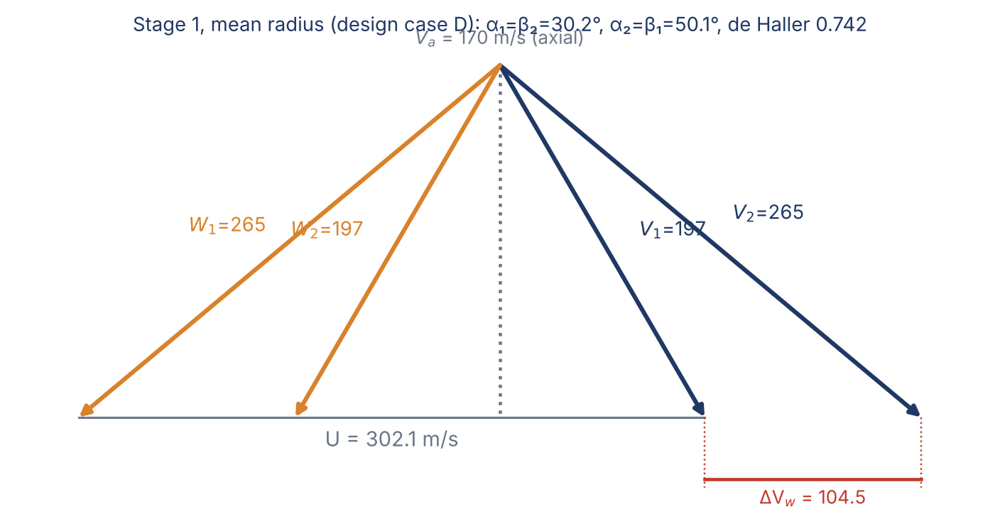
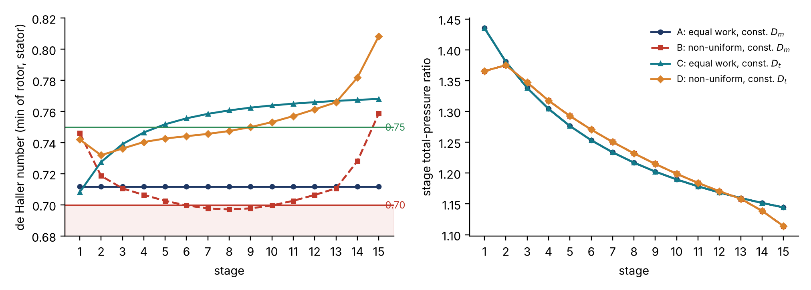
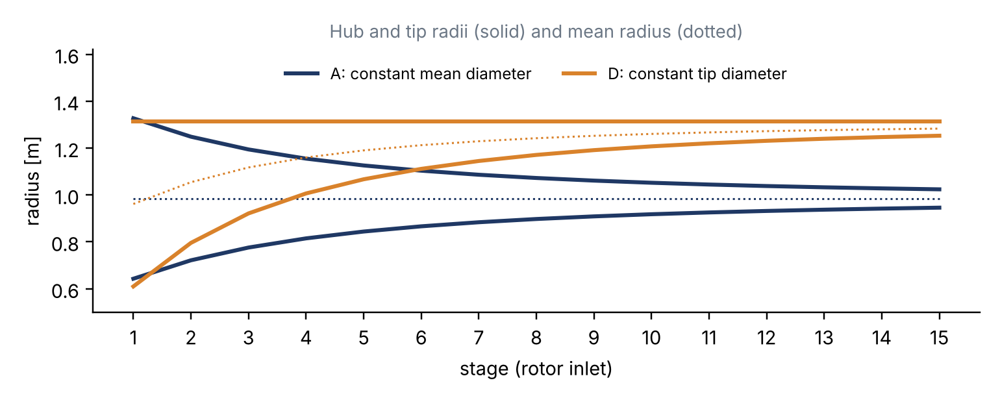

::: {custom-style="Cover Institution"}
Amirkabir University of Technology (Tehran Polytechnic)
:::

::: {custom-style="Cover Course"}
Department of Mechanical Engineering · Turbomachinery Course Project
:::

::: {custom-style="Cover Title"}
Redesign of the Mitsubishi Power M701JAC Axial Compressor
:::

::: {custom-style="Cover Subtitle"}
Report 2 — Thermodynamic and Gas-Dynamic Design from Limited Information
:::

::: {custom-style="Cover Target"}
448 MW ISO rating · 15 stages · pressure ratio 25 · 3000 rpm
:::

::: {custom-style="Cover Meta"}
**Prepared by:** Alireza Bayati  ·  Melika Bali

**Supervisor:** Dr. Nader Montazerin

**Date:** 15 Aban 1405 (6 November 2026)
:::

::: {custom-style="Cover Note"}
Prepared with the assistance of Claude (Anthropic); see Section 11. All calculations are reproducible with `m701jac/report2/report2_calc.py` in the project repository.
:::

```{=openxml}
<w:p><w:r><w:br w:type="page"/></w:r></w:p>
<w:p><w:pPr><w:pStyle w:val="TOCHeading"/></w:pPr><w:r><w:t>Contents</w:t></w:r></w:p>
<w:p><w:r><w:fldChar w:fldCharType="begin" w:dirty="true"/></w:r><w:r><w:instrText xml:space="preserve"> TOC \o "1-1" \h \z \u </w:instrText></w:r><w:r><w:fldChar w:fldCharType="separate"/></w:r><w:r><w:t>[The table of contents is generated by Word: if it is not shown, right-click here and choose “Update Field”.]</w:t></w:r><w:r><w:fldChar w:fldCharType="end"/></w:r></w:p>
```

# Why the M701JAC

The Phase 1 proposal took a 1990s-generation heavy-duty compressor (MAPNA MGT-70, pressure ratio 12 in 16 stages) as its subject. For the redesign we moved to the **Mitsubishi Power M701JAC**, because it represents the current limit of what an industrial axial compressor is asked to do. The reasons are engineering ones:

* **Highest efficiency class.** 44.0 % simple-cycle and above 64 % combined-cycle efficiency (LHV) [D2] place it among the most efficient heavy-duty gas turbines. Since the compressor absorbs roughly half of the turbine work (Section 5), such efficiency is only possible with a very good compressor.
* **Very high stage loading.** A pressure ratio of 25 in only 15 stages means an average stage pressure ratio of 1.24, against 1.17 in the Phase 1 machine. This requires transonic front stages, three-dimensional blading and boundary-layer control [D6–D8]. These are exactly the gas-dynamic problems this course studies.
* **The compressor enables the hot section.** The 1650 °C-class turbine inlet temperature raises the exhaust temperature unless the pressure ratio rises with it. The compressor was redesigned from PR 23 to PR 25 precisely to hold the exhaust temperature down [D4]. The compressor is therefore the key to the cycle, not a passive component.
* **Operability.** Variable inlet guide vanes plus three rows of variable stator vanes control rotating stall at start-up and keep the exhaust temperature high at part load. The machine has 50 % turndown, a 53 MW/min ramp rate and a 30-minute start [D1, D6]. These are the requirements of a modern grid with a large renewable share.
* **Suited to the Iranian grid.** It is a 50 Hz machine with direct drive at 3000 rpm and no gearbox. It burns natural gas or oil [D3], and Mitsubishi offers a conversion path to hydrogen firing [D2].
* **Proven reliability.** The J-series fleet has more than three million operating hours [D2]; ten M701JAC units in Thailand alone total 6,700 MW [D3].

# The machine and how its compressor works

The working principle and the theory of Report 1 apply unchanged. Only the machine changes. Its main data [D2, D5, D6]:

| Item | M701JAC (448 MW rating) |
|:----------------------------|:---------------------------------------------------------|
| Output / efficiency (ISO, LHV) | 448 MW / 44.0 % (heat rate 8182 kJ/kWh) |
| Compressor | Axial, 15 stages, 3-D blading; variable IGV + variable stator vanes on stages 1–3 |
| Total pressure ratio | 25 |
| Speed | 3000 rpm (50 Hz, cold-end direct drive) |
| Exhaust flow / temperature | 765 kg/s / 663 °C |
| Turbine | 4 stages, all blade and vane rows air-cooled; 1650 °C class |
| Published compressor features | transonic front stages (shock-loss reduction); start-up bleeds at low, middle and high pressure; rotating stall disappears at ≈ 60 % speed |

Table: Table 1. Main data of the M701JAC.

Each stage is a rotor that adds swirl, and therefore work, followed by a stator that removes it. Both rows act as diffusers: the rotor in the relative frame ($W_2<W_1$) and the stator in the absolute frame ($V_3<V_2$). The relations used below are those of Report 1, in the notation of the course:

$$ \frac{T_{02}}{T_{01}}=r_p^{\frac{\gamma-1}{\gamma\,\eta_{pc}}},\qquad \eta_{isc}=\frac{r_p^{(\gamma-1)/\gamma}-1}{r_p^{(\gamma-1)/(\gamma\eta_{pc})}-1} \qquad\qquad (1)$$

$$ \Delta h_0=U\,\Delta V_w,\qquad \frac{V_a}{U}=\phi,\qquad \frac{\Delta h_0}{U^2}=\psi \qquad\qquad (2)$$

$$ R=\frac{h_2-h_1}{h_3-h_1}=0.5\ \Rightarrow\ V_{w1}=\frac{U-\Delta V_w}{2},\quad V_{w2}=V_{w1}+\Delta V_w,\quad W_1=V_2,\ W_2=V_1 \qquad\qquad (3)$$

$$ T=T_0-\frac{V^2}{2c_p},\qquad p=p_0\left(\frac{T}{T_0}\right)^{\frac{\gamma}{\gamma-1}},\qquad M_{rel}=\frac{W}{\sqrt{\gamma R T}} \qquad\qquad (4)$$

$$ \text{de Haller: }\ \frac{W_2}{W_1}\ (\text{rotor}),\ \ \frac{V_3}{V_2}\ (\text{stator}):\quad \ge 0.75\ \text{light},\ \ 0.70\text{–}0.75\ \text{heavy},\ \ <0.70\ \text{not acceptable} \qquad\qquad (5)$$

# Assumed values

Every value below is either an ISO or physical standard, a course (class) value, a common-practice value, or a design choice made in this report. **Nothing else enters the calculations.**

| Quantity | Value | Type | Use / remark |
|:-------------------------------|:--------------|:-------------|:-----------------------------------------------|
| Inlet total state $T_{01}$, $p_{01}$ | 288.15 K, 101.325 kPa | ISO standard | Basis of the catalogue rating |
| Air: $\gamma$, $c_p$, $R$ | 1.4, 1004.5 J/kg·K, 287 J/kg·K | Class value | Perfect gas throughout |
| Combustion gas: $\gamma_g$, $c_{pg}$ | 1.333, 1148 J/kg·K | Common practice | Turbine and exhaust in the cycle check only |
| Fuel lower heating value | 50.0 MJ/kg | Standard (methane) | Fuel and air flows (±4 % LHV changes air flow by ±0.1 %) |
| Generator + mechanical efficiency | 0.985 | Common practice | Shaft power for the cycle check |
| Combustor pressure loss | 4 % of $p_{02}$ | Common practice (3–5 %) | Turbine pressure ratio |
| Turbine exit pressure | 1.02 × ambient | Common practice | Exhaust diffuser and duct |
| Turbine polytropic efficiency $\eta_{pe}$ | 0.90–0.92 | Common practice | Cooled turbine at its practical best; *fixes* $\eta_{pc}$ (Section 5) |
| Compressor polytropic efficiency $\eta_{pc}$ | **0.86** | Derived (Section 5) | Inside the band 0.84–0.875 implied by the catalogue |
| Axial velocity $V_a$ | 170 m/s, constant | Design choice | Inlet axial Mach 0.51; class rule of constant $V_a$ |
| First-rotor hub-to-tip ratio | 0.50 | Design choice | Typical heavy-duty first stage (0.40–0.55) |
| Degree of reaction | 0.5 at mean radius, all stages | Class value | Symmetric velocity triangles |
| Stage work distribution | equal, or non-uniform (stage 1 = 0.85, stage 15 = 0.80 × mean) | Design choice | Both are calculated (Section 8) |
| Annulus shape | constant mean or constant tip diameter | Design choice | Both are calculated (Section 8) |
| Radial whirl distribution | free vortex ($V_w r$ = const) | Common practice | Tip relative Mach number only |
| de Haller limits | 0.75 / 0.70 | Class value | Equation (5) |
| Blade density, taper factor | 7800 kg/m³, 0.6 | Common practice | Stage-1 root stress only |

Table: Table 2. All assumed values used in this report.

# Design basis and air flow

The catalogue fixes the heat input from the heat rate, and the fuel and air flows follow:

$$ \dot Q=P\cdot HR=448\times\frac{8182}{3600}=1018.2\ \text{MW},\qquad \dot m_f=\frac{\dot Q}{LHV}=20.36\ \text{kg/s},\qquad \dot m_a=765-20.36=744.6\ \text{kg/s} \qquad\qquad (6)$$

The compressor must therefore deliver **744.6 kg/s at a total-pressure ratio of 25**. The overall energy balance $\dot Q-\dot m_{exh}c_{pg}(T_{exh}-T_{01})$ = 449.1 MW of shaft power, against 448/0.985 = 454.8 MW required. It closes to within 0.6 % of the heat input, so the catalogue data are consistent.

# Cycle and compressor efficiency

The cycle is evaluated with the course method:

$$ T_{02}=T_{01}\,r_p^{\frac{\gamma-1}{\gamma\eta_{pc}}},\qquad \dot W_C=\dot m_a c_p(T_{02}-T_{01}),\qquad \dot m_{g}c_{pg}(T_{03}-T_{01})=\dot m_a c_p(T_{02}-T_{01})+\dot Q \qquad\qquad (7)$$

$$ \frac{T_{03}}{T_{04}}=\left(\frac{p_{03}}{p_{04}}\right)^{\frac{\gamma_g-1}{\gamma_g}\eta_{pe}},\qquad T_{04}=663\ ^\circ\text{C},\qquad \frac{p_{03}}{p_{04}}=\frac{25\times0.96}{1.02}=23.53 \qquad\qquad (8)$$

$T_{03}$ is the equivalent mixed turbine-inlet temperature, with the cooling air included. For any assumed compressor efficiency, equation (7) gives $T_{02}$ and $T_{03}$, and equation (8) then gives the turbine efficiency that the catalogue exhaust temperature requires:

| η_pc | T₀₂ [K] | Ẇ_C [MW] | T₀₃ [°C] | Implied η_pe | η_isc | Ẇ_C / Ẇ_T |
|:----:|:-----:|:-----:|:-----:|:-----:|:-----:|:-----:|
| 0.82 | 884.5 | 446.1 | 1682 | 0.934 | 0.729 | 0.498 |
| 0.84 | 861.2 | 428.6 | 1662 | 0.921 | 0.759 | 0.488 |
| **0.86** | **839.6** | **412.4** | **1644** | **0.909** | **0.788** | **0.479** |
| 0.88 | 819.4 | 397.4 | 1627 | 0.897 | 0.818 | 0.469 |
| 0.90 | 800.6 | 383.3 | 1611 | 0.886 | 0.848 | 0.460 |

Table: Table 3. Cycle closure for a range of compressor efficiencies (448 MW rating).

A turbine has few stages, accelerating flow and no stall, so its efficiency is close to the best attainable. For a cooled heavy-duty turbine that is $\eta_{pe}$ = 0.90–0.92. Table 3 then fixes the compressor at $\eta_{pc}$ = **0.84–0.875**, clearly lower than the turbine, as expected for a decelerating, stall-limited machine. We adopt **$\eta_{pc}$ = 0.86**. Two independent checks support it:

* the implied turbine efficiency is 0.909;
* the mixed turbine-inlet temperature is 1644 °C, matching the published 1650 °C class [D3, D4].

**Compressor result:** delivery temperature $T_{02}$ = **839.6 K (566 °C)**, isentropic efficiency **0.788**, shaft power **412 MW**. The compressor absorbs **48 %** of the turbine work.

*Note.* With temperature-dependent $c_p$ (real gas), $T_{02}$ is 811 K instead of 840 K, while the work changes by less than 1 %. The perfect-gas values are kept for consistency with the course method.

# Mean-line sizing

**Inlet annulus.** At the IGV inlet the flow is axial, with $V_a$ = 170 m/s:

$$ T_1=288.15-\frac{170^2}{2\times1004.5}=273.76\ \text{K},\quad p_1=84.70\ \text{kPa},\quad \rho_1=1.078\ \text{kg/m}^3,\quad A_1=\frac{\dot m_a}{\rho_1V_a}=4.063\ \text{m}^2 $$

With a hub-to-tip ratio of 0.50: $D_t$ = 2.626 m, $D_h$ = 1.313 m, $D_m$ = 1.970 m, and the inlet axial Mach number is 0.513.

**Loading.** The total work is $\Delta h_0=c_p(T_{02}-T_{01})$ = 553.9 kJ/kg, which is **36.93 kJ/kg per stage** on average. With a constant mean diameter of 1.970 m, $U_m=\pi D_mN/60$ = 309.4 m/s, $\phi$ = 0.549 and

$$ \frac{\Delta h_0}{U^2}\Big|_{total}=\frac{553.9\times10^3}{309.4^2}=5.786,\qquad \frac{\Delta h_0}{U^2}\Big|_{stage}=\frac{5.786}{15}=0.386,\qquad \Delta V_w=\frac{36.93\times10^3}{309.4}=119.3\ \text{m/s} $$

A stage-loading coefficient of 0.386 is high for an industrial compressor. It confirms the "high-load" character of this machine [D3].

# Stage 1: velocity triangles and gas dynamics

The design case selected in Section 8 has a constant tip diameter, which puts the stage-1 mean diameter at 1.923 m ($U$ = 302.1 m/s). With about 0.85 × mean work in stage 1 ($\Delta h_0$ = 31.6 kJ/kg) and $R$ = 0.5, equations (2)–(4) give:

| Quantity | Value | Quantity | Value |
|:----------------------|:--------|:----------------------|:--------|
| $U$, $V_a$, $\phi$ | 302.1 m/s, 170 m/s, 0.563 | $\psi$, $\Delta V_w$ | 0.346, 104.5 m/s |
| $V_{w1}$ / $V_{w2}$ | 98.8 / 203.3 m/s | $\alpha_1=\beta_2$ / $\alpha_2=\beta_1$ | 30.2° / 50.1° |
| $V_1=W_2$ | 196.6 m/s | $V_2=W_1$ | 265.0 m/s |
| Static $T_1$, $p_1$ | 268.9 K, 79.55 kPa | $M_1$ (absolute) | 0.598 |
| $M_{rel}$ at mean radius | 0.806 | $M_{rel}$ at tip (free vortex) | **1.157** |
| de Haller, rotor = stator | **0.742** | Stage pressure ratio | 1.365 |

Table: Table 4. Stage 1 at mean radius (design case D).

{width=78%}

Two results stand out:

* **The tip is transonic** ($M_{rel}$ = 1.16 at the tip, 0.81 at mean radius). This is why MHI uses three-dimensional design to reduce shock losses in the initial stages [D6]. It is also why the first stage cannot carry full load.
* **The de Haller number of 0.742 lies in the heavy-loading band** (0.70–0.75). Under the course criterion such a stage needs advanced blade design. This agrees with the published description of a high-loading, boundary-layer-controlled compressor [D7, D8].

# Stage-by-stage design: four ways

With only the overall pressure ratio known, the work split between stages and the annulus shape must be chosen. Both choices were calculated in all four combinations, each reproducing PR 25 and 744.6 kg/s exactly:

| Case | Work distribution | Annulus | Max ψ | Min de Haller (stage) | Stage PR 1 / 15 | Blade height 1 / 15 | Stage-1 tip M_rel |
|:--:|:-----------|:-----------|:----:|:--------:|:--------:|:--------:|:----:|
| A | equal | constant D_m = 1.970 m | 0.386 | 0.712 (all) | 1.435 / 1.144 | 684 / 78 mm | 1.173 |
| B | non-uniform | constant D_m | 0.411 | **0.697 (8)** | 1.365 / 1.114 | 690 / 77 mm | 1.160 |
| C | equal | constant D_t = 2.626 m | 0.401 | 0.708 (1) | 1.435 / 1.144 | 696 / 62 mm | 1.171 |
| **D** | **non-uniform** | **constant D_t** | **0.346** | **0.732 (2)** | **1.365 / 1.114** | **703 / 61 mm** | **1.157** |

Table: Table 5. Four ways of distributing the work and shaping the annulus.

{width=100%}

**What the comparison shows:**

* **Equal work is not equal pressure ratio.** Even with equal work the stage pressure ratio falls from 1.435 to 1.144, because each stage starts hotter (cases A and C).
* **Non-uniform work at constant mean diameter fails** (case B). Moving work to the middle stages at constant blade speed pushes stages 6–10 below de Haller 0.70.
* **A constant tip diameter makes the non-uniform distribution work** (case D). The hub rises, so the mean radius and the blade speed grow from 302 to 403 m/s along the machine. The middle and rear stages can then take more work at a *lower* loading coefficient. The first two stages stay limited by the transonic tip and remain the most heavily loaded aerodynamically.
* **Case D is adopted as the redesign:** minimum de Haller 0.732, no stage below 0.70, and a loading that falls smoothly from 0.35 to 0.18.

{width=88%}

| Stage | f | ΔT₀ [K] | Stage PR | p₀ out [bar] | T₀ out [K] | D_m [m] | h [mm] | U [m/s] | φ | ψ | α₁/α₂ [°] | M tip | dH |
|:--:|:--:|:--:|:--:|:--:|:--:|:--:|:--:|:--:|:--:|:--:|:-------:|:--:|:--:|
| 1 | 0.855 | 31.4 | 1.365 | 1.38 | 319.6 | 1.923 | 703 | 302.1 | 0.563 | 0.346 | 30.2/50.1 | 1.157 | 0.742 |
| 2 | 0.970 | 35.7 | 1.375 | 1.90 | 355.2 | 2.109 | 518 | 331.2 | 0.513 | 0.327 | 33.3/52.3 | 1.053 | 0.732 |
| 3 | 1.005 | 37.0 | 1.347 | 2.56 | 392.2 | 2.234 | 392 | 351.0 | 0.484 | 0.301 | 35.8/53.3 | 0.962 | 0.736 |
| 4 | 1.024 | 37.7 | 1.318 | 3.38 | 429.8 | 2.320 | 307 | 364.4 | 0.467 | 0.285 | 37.5/54.0 | 0.889 | 0.740 |
| 5 | 1.041 | 38.3 | 1.293 | 4.37 | 468.1 | 2.380 | 246 | 373.9 | 0.455 | 0.275 | 38.6/54.5 | 0.831 | 0.743 |
| 6 | 1.054 | 38.8 | 1.271 | 5.55 | 506.9 | 2.424 | 202 | 380.8 | 0.446 | 0.268 | 39.3/54.9 | 0.784 | 0.744 |
| 7 | 1.063 | 39.1 | 1.250 | 6.93 | 545.9 | 2.458 | 168 | 386.1 | 0.440 | 0.263 | 39.9/55.1 | 0.743 | 0.746 |
| 8 | 1.066 | 39.2 | 1.232 | 8.54 | 585.1 | 2.484 | 142 | 390.2 | 0.436 | 0.258 | 40.4/55.3 | 0.708 | 0.747 |
| 9 | 1.063 | 39.1 | 1.215 | 10.38 | 624.2 | 2.504 | 122 | 393.4 | 0.432 | 0.254 | 40.8/55.4 | 0.677 | 0.750 |
| 10 | 1.054 | 38.8 | 1.199 | 12.44 | 662.9 | 2.520 | 106 | 395.9 | 0.429 | 0.248 | 41.2/55.5 | 0.650 | 0.753 |
| 11 | 1.041 | 38.3 | 1.184 | 14.73 | 701.2 | 2.534 | 93 | 398.0 | 0.427 | 0.243 | 41.6/55.5 | 0.626 | 0.757 |
| 12 | 1.024 | 37.7 | 1.170 | 17.24 | 738.8 | 2.544 | 82 | 399.6 | 0.425 | 0.237 | 41.9/55.5 | 0.604 | 0.761 |
| 13 | 1.005 | 37.0 | 1.158 | 19.97 | 775.8 | 2.553 | 74 | 401.0 | 0.424 | 0.231 | 42.2/55.4 | 0.585 | 0.766 |
| 14 | 0.930 | 34.2 | 1.139 | 22.74 | 810.0 | 2.560 | 66 | 402.1 | 0.423 | 0.212 | 43.0/55.1 | 0.564 | 0.782 |
| 15 | 0.804 | 29.6 | 1.114 | 25.33 | 839.6 | 2.566 | 61 | 403.0 | 0.422 | 0.183 | 44.1/54.5 | 0.542 | 0.808 |

Table: Table 6. The redesigned compressor, stage by stage (case D, rotor-inlet values at mean radius; f = stage work / mean stage work; M tip = relative Mach number at the blade tip; dH = de Haller number).

# Mechanical note

The first rotor carries the largest centrifugal load because it has the largest annulus area. With $\sigma=K\rho_b\omega^2A_1/2\pi$ the root stress is about **300 MPa** for a tapered steel blade, an acceptable level for compressor blade steels. The 50 Hz rotational frequency and its multiples, together with the stator blade-passing frequencies, are the excitations against which the front blades must be detuned [D6]. A detailed vibration analysis is outside the scope of this report.

# Results and conclusions

| Quantity | Redesign (case D) | Catalogue / published |
|:--------------------------------|:-------------------|:--------------------|
| Air mass flow | 744.6 kg/s | 765 kg/s exhaust − fuel |
| Total pressure ratio | 25.0 (15 stages) | 25 |
| Delivery temperature | 839.6 K (566 °C) | — |
| Compressor power / share of turbine work | 412 MW / 48 % | — |
| Polytropic / isentropic efficiency | 0.86 / 0.788 | — |
| Equivalent turbine inlet temperature | 1644 °C | 1650 °C class |
| Stage-1 tip diameter / tip relative Mach | 2.63 m / 1.16 | transonic front stages |
| Stage pressure ratio, first → last | 1.365 → 1.114 | — |
| Blade height, first → last | 703 → 61 mm | reduced outlet area |
| Lowest de Haller number | 0.732 (stage 2) | high-load design |

Table: Table 7. Summary of the redesign.

**Conclusions:**

1. The catalogue data close to within 0.6 %, so the redesign targets (744.6 kg/s, PR 25) are firm.
2. The turbine runs near its best attainable efficiency, so the catalogue fixes the compressor polytropic efficiency at 0.84–0.875. With 0.86 the machine delivers 840 K air and absorbs 412 MW, about half of the turbine work.
3. Equal pressure ratio per stage is not physical. Equal work already gives 1.43 → 1.14, and a realistic non-uniform distribution gives 1.37 → 1.11.
4. Of the four ways examined, only the constant-tip annulus allows the non-uniform work distribution within the de Haller limits. It is adopted as the redesign.
5. The first two stages are transonic at the tip and heavily loaded (de Haller 0.73–0.74), which explains the three-dimensional, high-loading design of the real machine.

**Next steps (Report 3):** blade numbers and chords from diffusion-factor limits; radial variation in stages 1–3; the role of the variable IGV and stators at off-design; the standard test and the virtual test.

# Use of AI

All calculations in this report were coded and run by Claude (Anthropic) under the team's direction. The method follows the course notes. Every assumed value is listed in Table 2 and was reviewed by the team. The AI also checked the catalogue data for consistency and compared the perfect-gas results with a real-gas calculation (Section 5 note).

# References {.unnumbered}

::: {custom-style="Reference"}
[D1] Mitsubishi Power, "M701J/JAC Series," product page, https://power.mhi.com/products/gasturbines/lineup/m701j (accessed October 2026).

[D2] Mitsubishi Power, *GTCC Gas Turbine Combined Cycle Power Plants*, catalogue, 2026.

[D3] Y. Takashima et al., "Successful 10 Units Completion of M701JAC Gas Turbine Combined Cycle in Thailand," *MHI Technical Review* 62(3), 2025.

[D4] K. Takamura et al., "Development of 1650°C Class Next Generation JAC Gas Turbine based on J Experience," *MHI Technical Review* 56(3), 2019.

[D5] S. Hada et al., "High-efficiency Gas Turbine Development applying 1600°C class 'J' Technology," *MHI Technical Review* 52(2), 2015.

[D6] S. Hada et al., "Test Results of the World's First 1,600°C J-series Gas Turbine," *MHI Technical Review* 49(1), 2012.

[D7] E. Ito et al., "Key Technologies for Ultra-High Temperature Gas Turbines," *MHI Technical Review* 52(2), 2015.

[D8] K. Ishizaka et al., "Key Technologies for 1700°C Class Ultra High Temperature Gas Turbine," *MHI Technical Review* 54(3), 2017.

[T1] S. L. Dixon and C. A. Hall, *Fluid Mechanics and Thermodynamics of Turbomachinery*, 7th ed. Butterworth-Heinemann, 2014.

[T2] H. I. H. Saravanamuttoo et al., *Gas Turbine Theory*, 7th ed. Pearson, 2017.

[T3] N. Montazerin, *Turbomachines: Basic Design and Application* (in Persian). Amirkabir University of Technology Press, 1999.
:::
