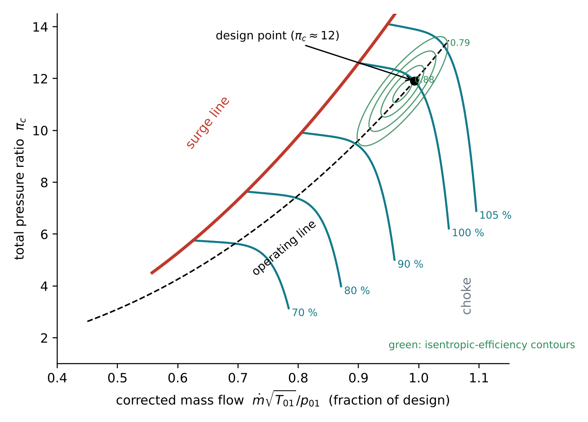
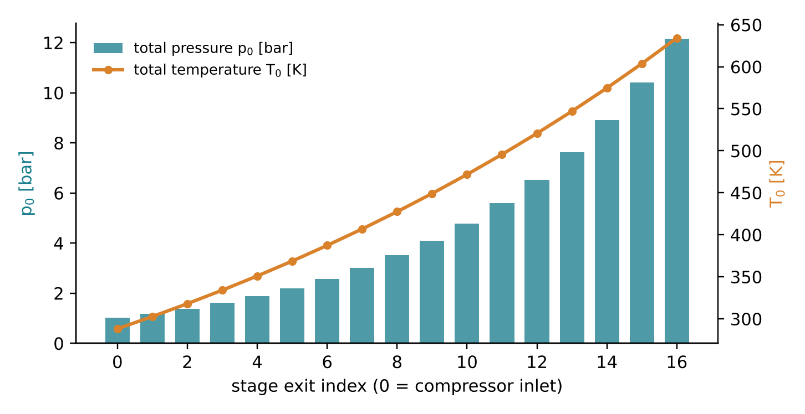
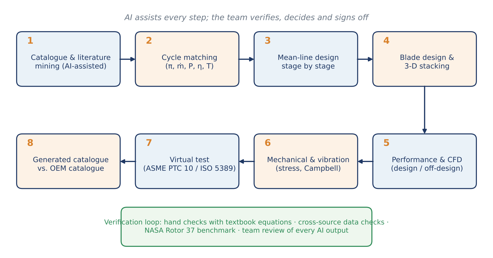
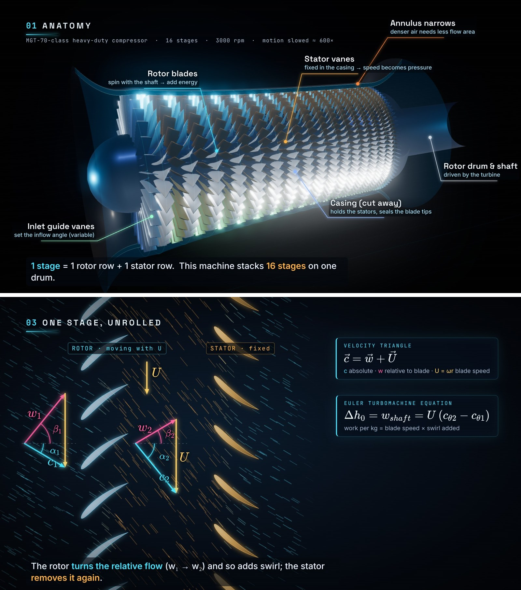

::: {custom-style="Cover Institution"}
Amirkabir University of Technology (Tehran Polytechnic)
:::

::: {custom-style="Cover Course"}
Department of Mechanical Engineering · Turbomachinery Course Project
:::

::: {custom-style="Cover Title"}
AI-Assisted Reverse Engineering of an Industrial Axial-Flow Compressor
:::

::: {custom-style="Cover Subtitle"}
Project Proposal — Phase 1: Machine Selection, Working Principles and Theoretical Framework
:::

::: {custom-style="Cover Target"}
Target machine: the 16-stage axial compressor of the MAPNA MGT-70(3) heavy-duty gas turbine
:::

::: {custom-style="Cover Meta"}
**Prepared by:** Alireza Bayati  ·  Melika Bali

**Supervisor:** Dr. Nader Montazerin

**Submitted:** 24 Mehr 1405 (16 October 2026)

**Accompanying deliverable:** silent explanatory video *Axial Compressor* (≈ 2 min, 1080p)
:::

::: {custom-style="Cover Note"}
This proposal was prepared with the assistance of the AI system Claude (Anthropic). The use of AI is a required and openly declared part of this project; its contribution is described in Section 10, and the prompt that initiated this work is reproduced in Appendix A.
:::

```{=openxml}
<w:p><w:r><w:br w:type="page"/></w:r></w:p>
<w:p><w:pPr><w:pStyle w:val="TOCHeading"/></w:pPr><w:r><w:t>Table of Contents</w:t></w:r></w:p>
<w:p><w:r><w:fldChar w:fldCharType="begin" w:dirty="true"/></w:r><w:r><w:instrText xml:space="preserve"> TOC \o "1-2" \h \z \u </w:instrText></w:r><w:r><w:fldChar w:fldCharType="separate"/></w:r><w:r><w:t>[The table of contents is generated by Word: if it is not shown, right-click here and choose “Update Field”.]</w:t></w:r><w:r><w:fldChar w:fldCharType="end"/></w:r></w:p>
<w:p><w:r><w:br w:type="page"/></w:r></w:p>
```

# Abstract {.unnumbered}

This proposal defines the course project for the Turbomachinery course at Amirkabir University of Technology. The project has two goals pursued in parallel: (i) to learn how an axial-flow compressor works, from its thermodynamics and fluid dynamics to its mechanical and vibration behaviour, and (ii) to evaluate how well current artificial-intelligence (AI) tools can support a specialised mechanical-engineering task. After a survey of publicly documented machines, the compressor of the MAPNA **MGT-70(3)** heavy-duty gas turbine (16 stages, pressure ratio 12, 3000 rpm) is proposed as the machine to be reverse-engineered, with the fully documented NASA Rotor 37 research stage as a validation benchmark for the method. The proposal presents the working principle of the machine, an introductory theoretical framework (stagnation properties, efficiencies, velocity triangles, the Euler equation, diffusion limits, radial equilibrium, performance maps, stall and surge, and blade stress and vibration) and a first-pass estimate of the selected compressor from catalogue data alone. That estimate gives an inlet air flow of about 543 kg/s, an outlet total temperature of about 634 K, a compressor power of about 189 MW, an inlet tip diameter of about 2.3 m and a transonic first-stage tip. It closes with the AI-assisted workflow, schedule, risks and a transparency statement. A silent, physics-based explanatory video of the axial compressor, produced entirely through AI-generated code, accompanies this document.

# Introduction

## Background

Turbomachines exchange energy between a continuously flowing fluid and a rotating shaft by means of blade rows. In compressors, shaft work is converted into an increase of the fluid's total enthalpy and pressure. The **axial-flow compressor**, in which the flow moves essentially parallel to the axis of rotation, is the standard choice whenever large mass flows must be compressed efficiently. It is the compressor of practically every jet engine and of every heavy-duty gas turbine used for power generation. In a modern gas turbine the compressor absorbs roughly half of the turbine's gross work. Its efficiency therefore has a first-order influence on the efficiency of the whole power plant, and its stability margin (surge margin) limits how the engine can be operated.

## Why an axial compressor?

The axial compressor has been assigned to our team from the course list of twelve turbomachines. It is a demanding but rewarding subject. A single stage can only raise the pressure modestly, because the flow must decelerate against an adverse pressure gradient without separating. The machine therefore consists of many stages, each of which must be matched to the others. Its study naturally combines thermodynamics (compression processes, efficiencies, losses), fluid dynamics (velocity triangles, diffusion, boundary layers, three-dimensional flow), and mechanics (centrifugal stress, blade vibration, rotordynamics), which is exactly the scope requested in the course brief.

## The role of artificial intelligence in this project

According to the course brief, AI is to be used throughout the project: to search catalogues, to propose a machine that it can reverse-engineer, to support the calculations, to perform a virtual test and to generate a catalogue for the redesigned machine. AI use is therefore not hidden in this work. It is part of what is being studied. We document what the AI did, how its outputs were checked, and where it helped or failed, so that the project also serves as an assessment of current AI capabilities in mechanical engineering.

# Objectives and Scope

## Dual objective

1. **Engineering objective:** understand and master the working principles of the axial compressor, and reverse-engineer a real, commercially documented compressor as completely as public information and engineering correlations allow.
2. **AI-study objective:** assess the strengths, weaknesses and most recent capabilities of AI tools when applied to the analysis and design of turbomachinery.

## Specific objectives

1. Survey manufacturer catalogues and the literature, and select one axial compressor for reverse engineering (completed in this proposal, Section 5).
2. Establish the theoretical framework (Section 4) and a first-pass estimate of the selected machine from catalogue data (Section 6).
3. Reconstruct the flow path and the stage-by-stage mean-line design: annulus geometry, velocity triangles, blade angles, blade numbers and chords.
4. Carry out the fluid-dynamic, thermodynamic, mechanical (stress) and vibration calculations required by the course brief.
5. Define a standard performance test (ASME PTC 10 / ISO 5389, with ISO 2314 for the gas-turbine context) and run a virtual test of the reconstructed machine with AI support.
6. Propose design improvements, issue a catalogue for the redesigned compressor and compare it with the original catalogue.

## Scope and limitations

The original equipment manufacturer's (OEM) blade geometry and test data are proprietary. The reverse engineering will therefore rely on catalogue data, published papers, photographs and accepted design correlations, and every inferred quantity will be reported with its assumptions. Detailed three-dimensional CFD is planned only for selected stages. Secondary air systems, sealing and control logic will be treated qualitatively.

# Working Principle of the Axial-Flow Compressor

## Architecture and main components

An axial compressor consists of alternating rows of rotating blades (**rotors**) and stationary vanes (**stators**). One rotor row followed by one stator row forms a **stage**. Figure 1 shows the meridional section of a 16-stage machine of the kind studied here, and Table 1 lists its main components.

{width=100%}

| Component | Function |
|:-------------------|:--------------------------------------------------------------|
| Inlet bellmouth / casing | Accelerates ambient air smoothly into the annulus; carries the stator rows and seals the blade tips |
| Inlet guide vanes (IGV), often variable | Set the swirl entering the first rotor; variable IGVs throttle the flow at part load and protect against stall |
| Rotor blades | Mounted on the rotor drum/discs; turn the relative flow and add swirl, i.e. they transfer shaft work to the air |
| Stator vanes | Fixed to the casing; remove the swirl added by the rotor and diffuse the flow, converting kinetic energy into static pressure |
| Rotor drum / discs and shaft | Carry the rotor blades; the shaft is driven by the turbine on the same spool |
| Bleed ports and valves | Extract air for cooling/sealing and, at start-up, dump air to keep the front stages away from stall |
| Outlet guide vanes and diffuser | Remove residual swirl and decelerate the flow before the combustor |
| Bearings, seals, casing structure | Support the rotor, limit leakage and maintain small tip clearances |

Table: Table 1. Main components of an axial compressor and their functions.

## How a stage works

Air enters the rotor with an absolute velocity $c_1$. Seen from the moving blade, which travels at the blade speed $U=\omega r$, the air arrives with the relative velocity $w_1$. The rotor passage is shaped so that it turns this relative flow towards the axial direction and slightly widens. The relative velocity falls ($w_2<w_1$), so the static pressure rises, and because the flow is turned the absolute tangential velocity (swirl) increases from $c_{\theta 1}$ to $c_{\theta 2}$. This increase of swirl is the mechanism by which the shaft does work on the air. The stator then turns the flow back towards its original direction, removing the swirl and decelerating the absolute flow ($c_3<c_2$), so the static pressure rises again. A stage therefore works like a pair of diffusers in series: one in the rotating frame and one in the stationary frame (Figure 2).

## Why many stages?

Because the pressure rises along the flow, the boundary layers on the blade surfaces and end walls grow against an **adverse pressure gradient**. If the deceleration is too strong, the boundary layers separate, losses rise sharply and the blade row stalls. A practical subsonic stage is therefore limited to a pressure ratio of roughly 1.15–1.35, and a pressure ratio of 12 requires about 16 stages (since $1.168^{16}\approx 12$). As the density increases from stage to stage, the axial velocity can be kept nearly constant only if the annulus area decreases, which is why the blades become progressively shorter towards the rear of the machine.

## Applications

Axial compressors are used in aero-engines (turbofans, turbojets, turboprops), in heavy-duty and aero-derivative gas turbines for power generation and mechanical drive, in large industrial air services (air-separation units, blast-furnace blowers, fluid-catalytic-cracking units), and in wind tunnels. They are preferred over centrifugal compressors when the mass flow is large and high efficiency and a small frontal area are required.

# Theoretical Framework (Introductory Level)

## Assumptions and nomenclature

At this introductory level we treat air as a calorically perfect gas ($c_p=1005$ J/kg·K, $\gamma=1.4$, $R=287$ J/kg·K) and assume steady, adiabatic flow analysed along the mean radius (mean-line analysis). Station 1 is the rotor inlet, station 2 the rotor outlet/stator inlet and station 3 the stator outlet. Subscript 0 denotes stagnation (total) conditions, $\theta$ the tangential and $x$ the axial component.

| Symbol | Meaning | Symbol | Meaning |
|:-----------|:--------------------------|:-----------|:--------------------------|
| $c$ | absolute velocity | $w$ | velocity relative to the blade |
| $U=\omega r$ | blade speed | $\alpha,\ \beta$ | absolute / relative flow angle (from axial) |
| $h,\ h_0$ | static / total specific enthalpy | $T,\ T_0$ | static / total temperature |
| $p,\ p_0$ | static / total pressure | $\rho$ | density |
| $\dot m$ | mass flow rate | $A$ | annulus area |
| $\pi_c,\ \pi_{st}$ | compressor / stage total-pressure ratio | $\eta_c,\ \eta_p$ | isentropic / polytropic efficiency |
| $\phi,\ \psi$ | flow / stage-loading coefficient | $R$ | degree of reaction |
| $\sigma$ | solidity (chord/pitch) | $DF$ | Lieblein diffusion factor |
| $N$ | rotational speed (rpm) | $\sigma_c$ | centrifugal blade stress |

Table: Table 2. Principal nomenclature.

## Thermodynamics of compression

**Stagnation properties.** Bringing the flow isentropically to rest defines the total enthalpy, temperature and pressure:

$$ h_0=h+\frac{1}{2}c^2,\qquad T_0=T+\frac{c^2}{2c_p},\qquad \frac{p_0}{p}=\left(\frac{T_0}{T}\right)^{\frac{\gamma}{\gamma-1}} \qquad\qquad (1)$$

**Energy equation.** For steady adiabatic flow through the compressor, the steady-flow energy equation reduces to a statement that all shaft work appears as a rise in total enthalpy:

$$ \dot W_c=\dot m\,(h_{0,\mathrm{out}}-h_{0,\mathrm{in}})=\dot m\,c_p\,(T_{0,\mathrm{out}}-T_{0,\mathrm{in}}) \qquad\qquad (2)$$

**Isentropic efficiency.** The ideal (reversible, adiabatic) work is compared with the actual work for the same pressure ratio:

$$ \eta_c=\frac{h_{03s}-h_{01}}{h_{03}-h_{01}}=\frac{\pi_c^{(\gamma-1)/\gamma}-1}{T_{03}/T_{01}-1} \qquad\qquad (3)$$

**Polytropic (small-stage) efficiency.** For a multistage machine it is more useful to define the efficiency of an infinitesimal compression step, $\eta_p=dh_s/dh$, which gives

$$ \frac{T_{03}}{T_{01}}=\pi_c^{\frac{\gamma-1}{\gamma\,\eta_p}},\qquad \eta_c=\frac{\pi_c^{(\gamma-1)/\gamma}-1}{\pi_c^{(\gamma-1)/(\gamma\eta_p)}-1} \qquad\qquad (4)$$

Because each stage starts from a higher temperature, the losses of the front stages increase the work required by the later stages (the *preheat* effect). As a result $\eta_c<\eta_p$ for a compressor, and the difference grows with the pressure ratio.

**Stage pressure ratio.** For a stage with total temperature rise $\Delta T_{0,st}$ and stage efficiency $\eta_{st}$,

$$ \pi_{st}=\left[1+\frac{\eta_{st}\,\Delta T_{0,st}}{T_{01}}\right]^{\frac{\gamma}{\gamma-1}} \qquad\qquad (5)$$

**Entropy and losses.** Irreversibilities (friction in boundary layers, mixing of wakes, shocks, tip leakage) appear as entropy generation:

$$ s_2-s_1=c_p\ln\frac{T_2}{T_1}-R\ln\frac{p_2}{p_1} \qquad\qquad (6)$$

Figure 3 shows the compression process of a single stage on the temperature–entropy (equivalently enthalpy–entropy) diagram.

{width=72%}

## Fluid dynamics of a stage

**Continuity.** With the mean axial velocity $c_x$ and the annulus area $A$:

$$ \dot m=\rho\,c_x\,A=\text{const.} \qquad\qquad (7)$$

**Velocity triangles.** The absolute velocity is the vector sum of the relative velocity and the blade velocity. Measuring $\alpha$ and $\beta$ from the axial direction, with $\beta$ positive against the direction of rotation, gives

$$ \vec c=\vec w+\vec U,\qquad U=c_x\left(\tan\alpha_1+\tan\beta_1\right)=c_x\left(\tan\alpha_2+\tan\beta_2\right) \qquad\qquad (8)$$

{width=95%}

**Euler's turbomachinery equation.** Applying the moment-of-momentum equation to the rotor gives the specific work:

$$ \Delta h_0=U_2c_{\theta2}-U_1c_{\theta1} \qquad\qquad (9)$$

For an axial stage ($U_1=U_2=U$, $c_x$ constant) this becomes

$$ \Delta h_0=U\,(c_{\theta2}-c_{\theta1})=U\,c_x\,(\tan\alpha_2-\tan\alpha_1)=U\,c_x\,(\tan\beta_1-\tan\beta_2) \qquad\qquad (10)$$

**Rothalpy.** In the rotating frame of an axial rotor the relative total enthalpy is conserved:

$$ I=h+\frac{1}{2}w^2-\frac{1}{2}U^2=\text{const.}\quad\Rightarrow\quad h_2-h_1=\frac{1}{2}\left(w_1^2-w_2^2\right) \qquad\qquad (11)$$

which shows directly that the static pressure rises in the rotor only if the relative flow is decelerated.

**Dimensionless design parameters.** The flow coefficient, the stage-loading coefficient and the degree of reaction characterise the shape of the velocity triangles:

$$ \phi=\frac{c_x}{U},\qquad \psi=\frac{\Delta h_0}{U^2}=\phi\left(\tan\beta_1-\tan\beta_2\right) \qquad\qquad (12)$$

$$ R=\frac{h_2-h_1}{h_3-h_1}=\frac{\phi}{2}\left(\tan\beta_1+\tan\beta_2\right) \qquad\qquad (13)$$

For $R=0.5$ the triangles are symmetric ($\alpha_1=\beta_2$, $\alpha_2=\beta_1$) and the static pressure rise is shared equally between rotor and stator. Typical values for industrial stages are $\phi\approx0.4$–$0.7$ and $\psi\approx0.3$–$0.45$.

## Diffusion, blade loading and losses

The amount of deceleration a blade row can sustain is limited. Two classical criteria are the de Haller number and the Lieblein diffusion factor:

$$ \frac{w_2}{w_1}\ \ge\ 0.72\ \ (\text{rotor}),\qquad \frac{c_3}{c_2}\ \ge\ 0.72\ \ (\text{stator}) \qquad\qquad (14)$$

$$ DF=1-\frac{w_2}{w_1}+\frac{\left|\Delta w_\theta\right|}{2\,\sigma\,w_1}\ \lesssim\ 0.45\text{–}0.6 \qquad\qquad (15)$$

where $\sigma=l/s$ is the solidity (chord over pitch). Losses are expressed by the total-pressure loss coefficient. The difference between the blade metal angle and the flow angle at outlet (the deviation $\delta$) can be estimated with Carter's rule, where $\theta$ is the camber angle and $m\approx0.23$–$0.3$:

$$ \bar\omega=\frac{p_{01,\mathrm{rel}}-p_{02,\mathrm{rel}}}{p_{01,\mathrm{rel}}-p_1},\qquad \delta\approx m\,\frac{\theta}{\sqrt{\sigma}} \qquad\qquad (16)$$

## Three-dimensional flow: radial equilibrium

Blade speed varies with radius, so the velocity triangles must vary along the span. The simple radial-equilibrium condition balances the radial pressure gradient against the centripetal acceleration of the swirling flow:

$$ \frac{1}{\rho}\frac{dp}{dr}=\frac{c_\theta^{\,2}}{r} \qquad\qquad (17)$$

A common solution is the **free-vortex** design, $r\,c_\theta=\text{const.}$ with $c_x=\text{const.}$, which gives the same work at all radii and leads to the characteristic twist of the blades: they are strongly staggered at the tip and more axial near the hub.

## Compressibility and Mach number

The mass flow that an annulus can pass is governed by the non-dimensional mass-flow function, which reaches a maximum (choking) at $M=1$:

$$ \frac{\dot m\sqrt{c_pT_0}}{A\,p_0}=\frac{\gamma}{\sqrt{\gamma-1}}\,M\left(1+\frac{\gamma-1}{2}M^2\right)^{-\frac{\gamma+1}{2(\gamma-1)}} \qquad\qquad (18)$$

When the relative Mach number at the rotor tip, $M_{1,\mathrm{rel}}=w_1/\sqrt{\gamma R T_1}$, exceeds unity, the stage is **transonic**. Shock waves then form in the blade passages, and the profiles must be specially shaped (for example multiple-circular-arc or controlled-diffusion profiles) to keep shock losses acceptable.

## Performance map, stall and surge

Dimensional analysis shows that the performance of a given compressor depends on two groups only, the corrected mass flow and the corrected speed:

$$ \pi_c,\ \eta_c=f\!\left(\frac{\dot m\sqrt{T_{01}}}{p_{01}},\ \frac{N}{\sqrt{T_{01}}}\right) \qquad\qquad (19)$$

which is the basis of the compressor characteristic, or map (Figure 4). If the machine is throttled at constant speed, the operating point moves towards lower flow and higher pressure ratio until the blades stall. **Rotating stall** consists of one or more stalled cells that travel around the annulus at roughly 20–70 % of rotor speed. **Surge** is a violent, system-wide oscillation of the flow, which may reverse momentarily. The surge margin quantifies the distance between the operating point and the surge line at constant corrected speed:

$$ SM=\frac{\pi_s/\dot m_s}{\pi_{op}/\dot m_{op}}-1 \qquad\qquad (20)$$

Variable inlet guide vanes and stators, bleed valves and multi-spool arrangements are used to keep a sufficient surge margin over the whole operating range.

{width=72%}

## Mechanical and vibration aspects

**Centrifugal stress.** At the root of a rotor blade of constant section the centrifugal stress depends only on the material density, the rotational speed and the annulus area:

$$ \sigma_{c,\mathrm{root}}=\rho_b\,\omega^2\,\frac{r_t^2-r_h^2}{2}=\rho_b\,\omega^2\,\frac{A}{2\pi}\quad(\times K\approx0.5\text{–}0.7\ \text{for tapered blades}) \qquad\qquad (21)$$

**Vibration.** Blades are excited by the wakes of neighbouring rows and by circumferential non-uniformities at integer multiples (engine orders $k$) of the rotational frequency. Resonance must be avoided at the operating speed. This is checked with a Campbell diagram, which plots the natural frequencies $f_n(N)$ (stiffened by centrifugal force) against speed and compares them with the excitation lines:

$$ f_{\mathrm{exc}}=k\,\frac{N}{60},\qquad f_{\mathrm{BP}}=Z\,\frac{N}{60} \qquad\qquad (22)$$

where $Z$ is the number of blades in the adjacent (exciting) row. The rotor as a whole must also operate safely away from its lateral critical speeds (rotordynamics).

# Candidate Machines and Selection

## Catalogue survey

In line with step 1 of the course brief, publicly documented axial compressors were surveyed with the help of the AI (web and literature search). Table 3 summarises the candidates. The figures are taken from manufacturers' public documents and the literature, and several of them depend on the rating basis or variant.

| Candidate | Type and application | Compressor | Pressure ratio | Flow | Speed | Public data |
|:--------------|:----------------|:--------------|:----------|:---------|:---------|:-----------------|
| **MAPNA MGT-70(3)** (Siemens V94.2 lineage) | Heavy-duty gas turbine, 50 Hz power generation, 185 MW, 36.4 % | 16-stage axial with variable IGV | 12 : 1 | 554 kg/s (exhaust) | 3000 rpm | MAPNA datasheet, papers, course material |
| Siemens Energy SGT-800 | Industrial gas turbine, 45–62 MW | 15-stage axial, variable vanes on first 3 stages | 18.3–22 : 1 | 115–138 kg/s (exhaust) | not given in poster | Siemens product poster |
| GE Aerospace LM2500 | Aero-derivative gas turbine, ≈ 25 MW, marine and industrial | 16-stage HP compressor, VIGV + 6 variable stator rows | ≈ 18 : 1 | ≈ 68 kg/s (exhaust) | power turbine 3600 rpm | GE / MTU datasheets |
| GE J85 | Small turbojet (T-38, F-5) | 8-stage axial (9 in J85-21) | ≈ 7–8.3 : 1 | ≈ 20–24 kg/s | ≈ 16 500 rpm | Open NASA/academic reports |
| NASA Rotor 37 / Stage 37 | Transonic research stage (CFD benchmark) | 1 stage, 36 rotor blades | 2.1 : 1 | 20.19 kg/s | 17 189 rpm | Full geometry and test data (NASA TP-1659) |

Table: Table 3. Candidate axial compressors identified in the catalogue and literature survey.

## Selection criteria and decision

The candidates were scored from 1 (poor) to 5 (excellent) against five weighted criteria. The scores in Table 4 are the team's qualitative judgement and were discussed with the AI.

| Criterion (weight) | MGT-70(3) | SGT-800 | LM2500 | J85 | Rotor 37 |
|:-------------------------------|:---:|:---:|:---:|:---:|:---:|
| Availability of public catalogue data (25 %) | 4 | 4 | 3 | 3 | 5 |
| Relevance to the course and to Iranian industry (20 %) | 5 | 3 | 3 | 2 | 2 |
| Suitability for a complete multistage reverse engineering (20 %) | 4 | 3 | 3 | 4 | 2 |
| Availability of data for validation (20 %) | 3 | 2 | 3 | 4 | 5 |
| Coverage of thermo-fluid, mechanical and vibration topics (15 %) | 5 | 4 | 4 | 4 | 2 |
| **Weighted score** | **4.15** | 3.20 | 3.15 | 3.35 | 3.35 |

Table: Table 4. Weighted decision matrix.

**Decision.** The compressor of the **MAPNA MGT-70(3)** gas turbine is proposed as the machine to be reverse-engineered. It is a locally manufactured, widely installed heavy-duty machine that is directly relevant to the Iranian power industry and to the course material, and its moderate pressure ratio and conventional 16-stage layout make a complete stage-by-stage reconstruction feasible within the course. Its public catalogue data are summarised in Table 5.

| Catalogue item (MGT-70(3)) | Value |
|:--------------------------------------|:----------------------------|
| Gas-turbine output (ISO) | 185 MW |
| Gross efficiency | 36.4 % |
| Compressor | Axial, 16 stages, variable inlet guide vanes |
| Total pressure ratio | 12 |
| Exhaust mass flow | 554 kg/s |
| Shaft speed | 3000 rpm (50 Hz, direct drive) |
| Lineage | Upgrade of the MGT-70 (Siemens V94.2 class); public descriptions mention a 3-D redesign of the front compressor stages |

Table: Table 5. Public catalogue data of the selected machine.

## The AI's assessment: what can be "fully" reverse-engineered?

Step 2 of the brief asks the AI to propose a machine that it can reverse-engineer completely. The AI's answer was that, for any commercial machine, blade profiles, blade counts and test curves are proprietary. A *complete* reverse engineering of a commercial compressor therefore always combines catalogue data with engineering correlations, and the result is a consistent reconstruction rather than an exact copy. It recommended the MGT-70(3) as the target and, in addition, the NASA Rotor 37 transonic stage, whose full geometry and measured performance are public. Rotor 37 will be used as a **calibration and validation benchmark**: the same AI-assisted workflow will first be applied to Rotor 37 and its predictions compared with the published measurements before it is trusted for the MGT-70(3) compressor.

# Preliminary First-Pass Analysis of the Selected Compressor

## Inputs and assumptions

To show what can be inferred from the catalogue alone, a first-pass mean-line estimate was made, using equations (1)–(21) with the following assumptions. ISO inlet conditions ($T_{01}=288.15$ K, $p_{01}=101.325$ kPa) without inlet losses. Polytropic efficiency $\eta_p=0.90$. Natural-gas fuel with a lower heating value of 48 MJ/kg, so the inlet air flow is the exhaust flow minus the fuel flow. Inlet axial velocity 160 m/s, no inlet pre-swirl and an inlet hub-to-tip ratio of 0.50. Outlet axial velocity 130 m/s at constant mean radius. Steel blades ($\rho_b=7800$ kg/m³) with a taper factor $K=2/3$. These assumptions will be replaced by inferred values in Phase 2.

## Results

| Quantity | Estimate | Basis |
|:-------------------------------------------|:-----------------|:--------------------------|
| Heat input / fuel flow | 508 MW / 10.6 kg/s | $P/\eta$, LHV = 48 MJ/kg |
| Inlet air mass flow | ≈ 543 kg/s | exhaust flow − fuel flow |
| Mean stage pressure ratio | $12^{1/16}=1.168$ | Section 3.3 |
| Outlet total temperature $T_{02}$ | ≈ 634 K (isentropic: 586 K) | Eq. (4) |
| Isentropic efficiency $\eta_c$ | ≈ 0.86 | Eq. (4) |
| Total temperature rise (first / mean / last stage) | 346 K (14.6 / 21.6 / 30.5 K) | Eq. (4) |
| Compressor power $\dot W_c$ | ≈ 189 MW | Eq. (2) |
| Back-work ratio $\dot W_c/\dot W_t$ | ≈ 0.51 | $\dot W_t\approx\dot W_c+P$ |
| Inlet annulus area / tip, mean, hub diameter | 3.10 m² / 2.30, 1.72, 1.15 m | Eqs. (1), (7) |
| Blade speed at tip / mean radius (inlet) | 361 / 270 m/s | $U=\omega r$, $\omega=314.2$ rad/s |
| Relative Mach number at first-rotor tip | ≈ 1.19 (transonic) | Eq. (8), $a_1=333$ m/s |
| Mean-stage $\phi$, $\psi$ ($R=0.5$) | 0.59, 0.30 | Eqs. (12)–(13) |
| Mean-stage $\beta_1/\beta_2$; de Haller $w_2/w_1$ | 47.6° / 30.7°; 0.78 (> 0.72) | Eqs. (13)–(14) |
| Outlet annulus area / blade height | 0.65 m² / 0.12 m (inlet: 0.57 m) | Eq. (7), $\rho_{out}=6.5$ kg/m³ |
| First-rotor root centrifugal stress | ≈ 250 MPa | Eq. (21) |
| Rotational / first engine-order frequencies | 50 Hz; 100, 150, … Hz | Eq. (22) |

Table: Table 6. First-pass, catalogue-based estimate of the MGT-70(3) compressor (to be refined in Phase 2).

{width=72%}

## Interpretation

Even this simple estimate gives a coherent picture. The compressor absorbs about as much power as the gas turbine delivers to the grid, so roughly half of the turbine's work is fed back into compression. This explains why one percentage point of compressor efficiency is worth so much at plant level. The annulus area falls to about one fifth between inlet and outlet. The first-stage tip is transonic unless pre-swirl is used, which is consistent with the variable IGV and with the reported 3-D redesign of the front stages. The mean-stage loading ($\psi\approx0.30$) and de Haller number (0.78) are within normal limits for a robust industrial design, and the estimated root stress is moderate for a steel blade. Vibration margins, however, remain to be checked against the 50 Hz engine orders and the blade-passing excitations.

# Methodology: AI-Assisted Reverse-Engineering Workflow

## Workflow

The work will follow the eight-step workflow of Figure 6. AI assists every step, and the team verifies, decides and signs off.

{width=100%}

1. **Data mining:** collect catalogue data, technical papers, photographs and drawings; log every value with its source and rating basis.
2. **Cycle matching:** reconcile power, efficiency, pressure ratio, flows and temperatures in a consistent gas-turbine cycle model (including bleed and cooling flows).
3. **Mean-line design:** stage-by-stage design of the annulus, the velocity triangles and the work and reaction distribution, using the equations of Section 4 implemented in a Python mean-line code.
4. **Blade design:** blade numbers, chords and solidities from diffusion-factor limits; profiles (NACA-65 / DCA / MCA for transonic stages); free-vortex or controlled-vortex twist; 3-D stacking.
5. **Performance prediction:** loss and deviation correlations, off-design speed lines, surge-line estimate; CFD of selected stages for verification.
6. **Mechanical and vibration analysis:** centrifugal and gas-bending stresses, disc stresses, natural frequencies, Campbell diagram and critical speeds.
7. **Virtual testing:** apply the procedure of a standard performance test to the model, with the AI acting as a virtual test engineer.
8. **Catalogue generation and comparison:** issue a catalogue for the reconstructed and improved compressor and compare it with the OEM catalogue.

## AI tools and their roles

The principal AI tool is **Claude (Anthropic)**, used through *Claude Code*, an agentic environment in which the AI can search the web, read documents, write and run code and produce files. In this project the AI is used as (a) a research assistant (catalogue and literature search, summarising sources), (b) a tutor (deriving and explaining equations), (c) a programmer (mean-line solver, plotting, visualisation), (d) a reviewer (checking calculations and consistency) and (e) a technical writer (drafting documents). Other AI tools may be added in later phases, for example AI-assisted CFD set-up or surrogate models, and each use will be documented.

## Verification and validation

Every AI output is treated as a claim to be verified. Numbers are traced to a source or recomputed independently, by hand or in code. Key equations are re-derived by the team from the course references [1]–[13]. Conflicting public data are reported and not averaged away: for example, different editions of Siemens' SGT5-2000E data sheets quote pressure ratios between 12 and 21 for nominally similar ratings. Finally, the complete workflow will be validated on NASA Rotor 37 before it is applied to the MGT-70(3) compressor.

## Standard and virtual testing

The performance of the reconstructed compressor will be evaluated following the logic of **ASME PTC 10** (*Performance Test Code on Compressors and Exhausters*) and **ISO 5389** (*Turbocompressors — Performance test code*). These codes cover instrumentation planes, measured quantities (total pressures and temperatures, flow, speed, power), test-to-specified-condition similarity and uncertainty analysis. For the gas-turbine context, **ISO 2314** / **ASME PTC 22** acceptance-test practice will be referenced. In the virtual test, the AI will generate the test plan, apply it to the model and report the corrected performance map and the test uncertainty.

# Work Plan and Timeline

| Step | Activity | Deliverable | Due date |
|:--------:|:----------------------------------------------|:----------------------|:-----------------------|
| 1–3 | Catalogue survey, AI proposal, selection of the machine | Sections 5–6 of this proposal | completed |
| 4 | Submit the report on the selected machine; upload all information | This proposal + video | 24 Mehr 1405 (16 Oct 2026) |
| 5 | Reverse engineering with fluid, thermodynamic, vibration and mechanical calculations | Calculation package | Mehr–Aban 1405 |
| 6 | Report (≤ 15 pages); preparation for questions; upload | Technical report | 15 Aban 1405 (6 Nov 2026) |
| 7 | 10-slide presentation on progress and design improvement | Presentation | 6 Azar 1405 (27 Nov 2026) |
| 8 | Standard test procedure and AI virtual test | Test report | Azar 1405 |
| 9 | Catalogue of the redesigned machine; comparison with the original | Catalogue | Azar 1405 |
| 10 | Submission of all documents | Final package | 27 Azar 1405 (18 Dec 2026) |

Table: Table 7. Work plan aligned with the course brief.

# Expected Outcomes and Deliverables

* A documented, internally consistent reconstruction of the MGT-70(3) compressor: flow path, stage-by-stage velocity triangles, blade geometry, performance map, stresses and vibration margins.
* A validated, reusable AI-assisted workflow, benchmarked on NASA Rotor 37.
* A technical report (≤ 15 pages), a 10-slide presentation, a virtual test report and a catalogue of the redesigned compressor.
* An evaluation of the AI tools used, based on evidence: where they saved time, where they were wrong, and how errors were caught.
* **Phase-1 media deliverable:** a silent, physics-based explanatory video, *Axial Compressor* (≈ 2 min, 1920 × 1080, H.264, < 100 MB). The video shows the machine, its anatomy, the flow through it, one stage "unrolled" into a cascade with live velocity triangles, diffusion and pressure rise, the T–s diagram, the compressor map with rotating stall and surge, and the compressor's place in a gas turbine, with the governing equations shown alongside each principle. Its storyboard is given in Appendix B, and Figure 7 shows two frames.

{width=92%}

# Use of AI: Transparency Statement

In Phase 1 the AI (Claude, Anthropic, operating in Claude Code) performed the following tasks under the team's direction:

* read and summarised the course brief (in Persian) and the course reference list;
* searched public sources for catalogue data of candidate machines and flagged inconsistencies between sources;
* proposed the candidate list, the selection criteria and the benchmark strategy;
* derived, checked and typeset the equations of Section 4 and wrote the Python code for the first-pass estimate (Section 6) and for Figures 1–6;
* drafted the text of this proposal;
* wrote, from scratch, the code that procedurally builds the 3-D compressor model (twisted free-vortex blades, 16 stages, cut-away casing), simulates the flow particles and diagrams, renders the video frame by frame and encodes it.

The team defined the task (Appendix A), reviewed the outputs and takes full responsibility for the content. The numbers in Section 6 are first-pass estimates under the stated assumptions, not OEM data. Catalogue values reflect public sources available in October 2026.

# Risks and Mitigation

| Risk | Likelihood | Impact | Mitigation |
|:------------------------------------|:-----------:|:--------:|:-----------------------------------------------------|
| OEM blade geometry and test data are proprietary | High | High | Infer from catalogue data, papers, photographs and correlations; report results as ranges; calibrate on NASA Rotor 37 |
| Public data are inconsistent (ratings, editions, variants) | High | Medium | Cross-check at least two sources; record the rating basis; keep a data log |
| AI errors (wrong numbers, invented references) | Medium | High | Trace every value to a source or recompute it; check all references; team sign-off |
| Limited computing power for 3-D CFD | Medium | Medium | Rely on mean-line / streamline-curvature methods; limit CFD to one or two stages; open-source tools |
| Schedule pressure | Medium | Medium | Front-load the mean-line model; weekly milestones aligned with the course deadlines |
| Over-reliance on AI reduces learning | Medium | High | Team re-derives the key equations; AI used as tutor and checker; preparation for the oral questions |

Table: Table 8. Main risks and mitigation measures.

# References {.unnumbered}

::: {custom-style="Reference"}
[1] S. L. Dixon and C. A. Hall, *Fluid Mechanics and Thermodynamics of Turbomachinery*, 7th ed. Butterworth-Heinemann, 2014.

[2] S. A. Korpela, *Principles of Turbomachinery*, 2nd ed. Wiley, 2019.

[3] D. G. Wilson and T. Korakianitis, *The Design of High-Efficiency Turbomachinery and Gas Turbines*, 2nd ed. MIT Press, 2014.

[4] B. K. Sultanian, *Logan's Turbomachinery: Flowpath Design and Performance Fundamentals*, 3rd ed. CRC Press, 2019.

[5] E. Dick, *Fundamentals of Turbomachines*. Springer, 2015.

[6] E. A. Baskharone and D. L. Hill, *Principles of Turbomachinery in Air-Breathing Engines*, 2nd ed. Cambridge University Press, 2024.

[7] M. Gambini and M. Vellini, *Turbomachinery: Fundamentals, Selection and Preliminary Design*. Springer, 2021.

[8] D. Japikse and N. C. Baines, *Introduction to Turbomachinery*. Concepts ETI / Oxford University Press (course reference list, 2014).

[9] B. U. Pai, *Turbomachines*. Wiley, 2013.

[10] V. Dakshina Murty, *Turbomachinery: Concepts, Applications, and Design*. CRC Press, 2018.

[11] M. Dubey, B. V. S. S. S. Prasad and A. Nema, *Turbomachinery*. McGraw Hill Education (India), 2019.

[12] D. Walker, *Rotor Dynamics of Turbomachinery*, 2019.

[13] N. Montazerin, *Turbomachines: Basic Design and Application* (in Persian). Amirkabir University of Technology Press, 1999.

[14] N. Montazerin, G. Akbari and M. Mahmoodi, *Developments in Turbomachinery Flow: Forward Curved Centrifugal Fans*. Woodhead Publishing, 2015.

[15] H. I. H. Saravanamuttoo, G. F. C. Rogers, H. Cohen, P. V. Straznicky and A. C. Nix, *Gas Turbine Theory*, 7th ed. Pearson, 2017.

[16] S. Lieblein, F. C. Schwenk and R. L. Broderick, "Diffusion factor for estimating losses and limiting blade loadings in axial-flow-compressor blade elements," NACA RM E53D01, 1953.

[17] R. D. Moore and L. Reid, "Performance of single-stage axial-flow transonic compressor with rotor and stator aspect ratios of 1.19 and 1.26, respectively, and with design pressure ratio of 2.05," NASA TP-1659, 1980.

[18] MAPNA Group, "MGT-70(3) Power Gas Turbine," product datasheet. https://mapnaturbine.com/storage/2020/12/7347160810185992501-MGT-70%20(3).pdf

[19] MAPNA Group, "MGT-70 Gas Turbine," product page. https://mapnagroup.com/mapnaproducts/mgt-70-mgt-70-gas-turbine-turbine/?lang=en

[20] "Aero-Thermal Upgrade of Turbine Section in Mapna Heavy-Duty Gas Turbine MGT-70," conference paper. https://www.researchgate.net/publication/331880841

[21] Siemens Energy, "SGT-800 Industrial Gas Turbine," product poster, 2023. https://assets.siemens-energy.com/dam/78ead0ce-b5b2-4bc1-9caa-b05d00e5ba7c/Poster-SGT-800-ENG-230127-pdf_Original%20file.pdf

[22] Siemens, "SGT5-2000E heavy-duty gas turbine," product page and gas-turbine portfolio brochures. https://www.siemens-energy.com/us/en/home/products-services/product/sgt5-2000e.html

[23] GE Aerospace, "LM2500 aeroderivative gas turbine," datasheets; MTU Maintenance, "LM2500," https://mtu.de/engines/industrial-gas-turbines/lm2500

[24] ASME PTC 10, *Performance Test Code on Compressors and Exhausters*; ISO 5389, *Turbocompressors — Performance test code*; ISO 2314, *Gas turbines — Acceptance tests*; ASME PTC 22, *Performance Test Code on Gas Turbines*.
:::

# Appendix A — Project Prompt (Edited for Clarity) {.unnumbered}

Because this project is also a study of AI, the instruction that initiated the work is reproduced below. The original was written informally. It has been edited for clarity and formality only, and its content has been preserved.

::: {custom-style="Prompt"}
We are a two-member team, Alireza Bayati and Melika Bali, undertaking the course project of the Turbomachinery course at Amirkabir University of Technology (AUT) under the supervision of Dr. Nader Montazerin. The project brief and the course reference list are attached. As defined in the brief, the use of artificial intelligence is an integral part of the project. The project has two simultaneous goals: first, to study the capabilities, advantages and most recent advances of AI in this specialised field of mechanical engineering; and second, to learn the principles of turbomachines themselves.

The project is defined as follows:

• From the list of subjects, our team has been assigned the axial-flow compressor.

• We must prepare an initial proposal describing the work we intend to carry out. The use of AI is mandatory, and its contribution will be openly acknowledged rather than concealed.

• As described in the brief, we must first study and master how the assigned machine works. We will then select the catalogue of a real, commercially available unit and reverse-engineer it in as much depth as possible, using the latest AI capabilities.

Please provide the following deliverables:

1\. A formal project proposal in English, delivered as a Microsoft Word document in a professional format. It should give an introductory-level treatment of the mathematics, fluid dynamics and thermodynamics of what takes place in this type of machine.

2\. A silent video (no audio), serving as the principal showcase of the AI's capability in this project. The video should first present an axial compressor, then show exactly how it works and what it looks like in operation, displaying the relevant equations alongside each principle shown. The graphics should be visually striking yet technically accurate, so that viewers react in two ways at once: "this looks impressive" and "so this is how an axial compressor works." The video should be at most two minutes long and smaller than 100 MB, and it should include the team members' names.

3\. Since this project is also a study of AI, this prompt, edited for clarity and formality while preserving its content, should be included in the proposal.
:::

# Appendix B — Storyboard of the Accompanying Video {.unnumbered}

| Time | Chapter | What is shown | Equations on screen |
|:-------|:------------------|:--------------------------------------------------|:------------------------------|
| 0:00–0:07 | Title | Fly-over of the first-stage blades; title, team and supervisor | — |
| 0:07–0:22 | 01 Anatomy | Full 3-D 16-stage compressor with cut-away casing; labelled IGV, rotors, stators, casing, drum, narrowing annulus | — |
| 0:22–0:38 | 02 Follow the air | Thousands of particles stream through the machine, coloured by total temperature; live stage-by-stage pressure bar chart | $\dot m=\rho c_xA$, $\pi_c=\pi_{st}^N$, $T_{0,out}=T_{01}\pi_c^{(\gamma-1)/\gamma\eta_p}$ |
| 0:38–0:58 | 03 One stage, unrolled | Camera dives to the mean radius; 2-D cascade with moving rotor and fixed stator; velocity triangles drawn live | $\vec c=\vec w+\vec U$, Euler equation, $\phi$, $\psi$ |
| 0:58–1:14 | 04 Diffusion | Static-pressure field in the passages; $w_2<w_1$, $c_3<c_2$ | reaction $R$, de Haller, diffusion factor |
| 1:14–1:29 | 05 Thermodynamics | Animated T–s diagram with isentropic and actual paths and the 16-stage "staircase" | $\eta_c$, polytropic relation, $\dot W=\dot m c_p\Delta T_0\approx190$ MW |
| 1:29–1:44 | 06 Limits | Compressor map with the operating point throttled into surge; front view with rotating stall cells | similarity groups, surge margin |
| 1:44–1:53 | 07 Big picture | Compressor, combustor and turbine on one shaft; MGT-70(3) catalogue card | — |
| 1:53–1:58 | Credits | Project title, team, supervisor, university, AI credit | — |

Table: Table B1. Storyboard of the silent video (1920 × 1080, 30 fps, H.264, no audio).
