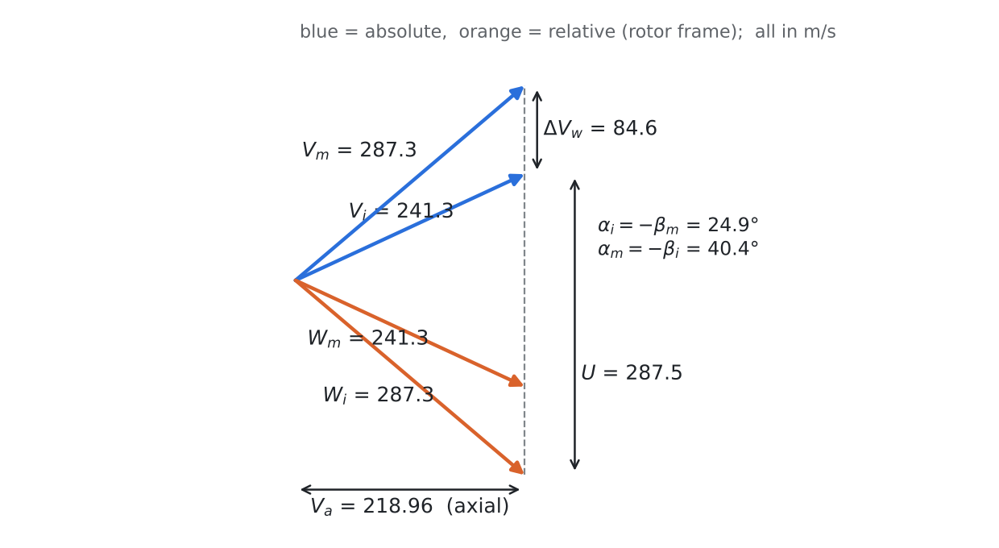
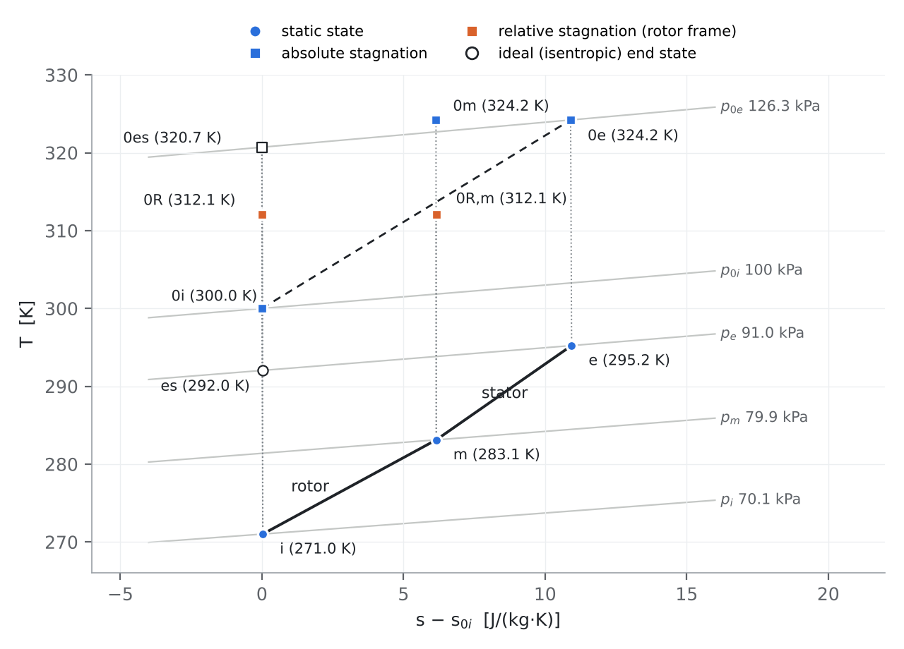

Turbomachinery course · Amirkabir University of Technology · personal study material, not for submission.
All numbers below were recomputed; each answer is checked against the answer printed in Korpela.

# 0  How to use this guide

**Scope rule.** Chapters 2 and 3 are covered in full from the book. Chapters 5 and 8 are limited to what the six compressor videos teach; everything else in them is listed as *out of scope* at the end of that part.

**Each problem type has:** the book exercise it comes from · *Same type:* other exercises with identical steps · numbered steps · a boxed answer · ✓ when it matches the book's printed answer (or a note when it does not).

**Priority tags:** CORE taught in the videos · BOOK in the exam chapters, not in the videos.

## 0.1  The six videos

| # | Video content (in order) | Book link | Advice |
|---|---|---|---|
| V1 | Polytropic efficiency of compression; why overall η_c is below η_p | §3.3.1 (same idea for a nozzle), Ex 8.19 | Watch fully (short, the derivation is asked) |
| V2 | Parts of the MGT-70 compressor; IGVs; how pressure rises: diffuser, normal shock, moving blades (relative velocity) | §8.1 intro, §3.5 | Watch fully (concept questions) |
| V3 | MGT-70 data; choosing $V_a$ and $D_m$; $U$; flow coefficient φ; blade height by continuity | §8.1, Ch 2 mass balance | Watch fully |
| V4 | Loading coefficient ψ (total and per stage); Euler equation $w=U\Delta V_w$; ΔV_w; compressor vs turbine cascade | §5.2–5.3, §8.1 | Watch fully |
| V5 | Degree of reaction; why 50 %; symmetric triangle; static/stagnation states i, m, e; relative Mach; pressure reaction | §5.3.2, §8.1.2 | **Most important — watch twice** |
| V6 | Full h–s (Mollier) diagram of the stage; relative stagnation states; total-to-total and total-to-static efficiency | §2.5, §8.1.2 (Fig 8.4) | Watch fully |

## 0.2  Notation: professor ↔ Korpela

| Quantity | Videos | Korpela |
|---|---|---|
| Rotor inlet / between rows / stator exit | i, m, e | 1, 2, 3 |
| Axial velocity | $V_a$ | $V_x$ |
| Tangential (whirl) component | $V_w$, $W_w$ | $V_u$, $W_u$ |
| Flow coefficient | φ = $V_a/U$ | φ = $V_x/U$ |
| Loading coefficient | ψ = Δh/U² | ψ = w/U² |
| Ideal end state | 2′ (prime) | 2s, 03s |
| Relative-flow angles | magnitudes (positive) | **negative** for a compressor rotor (β₁, β₂ < 0) |

Angles in Korpela are measured from the **axial** direction; $V_u = V_x\tan\alpha$, $W_u = V_x\tan\beta$, $W_u = V_u - U$.

# Part A — Chapter 2: Thermodynamics and fluid flow BOOK

**Read:** §2.1–2.6 (all). Skim §2.4.1 (steam tables) — you need it only to *look up* values. **Watch:** V6 for the efficiency definitions in a compressor.

## A.0  Formula sheet

| Topic | Relations |
|---|---|
| Mass flow | $\dot m=\rho A V$ (use the velocity component *normal* to the area) |
| First law (adiabatic) | $w = h_{01}-h_{02}$ (turbine), $w=h_{02}-h_{01}$ (compressor); $h_0=h+\tfrac12V^2(+gz)$ |
| Stagnation, ideal gas | $T_0=T+\dfrac{V^2}{2c_p}$, $\dfrac{p_0}{p}=\left(\dfrac{T_0}{T}\right)^{\gamma/(\gamma-1)}$, $\dfrac{T_0}{T}=1+\dfrac{\gamma-1}{2}M^2$ |
| Stagnation, liquid | $p_0=p+\tfrac12\rho V^2+\rho g z$; $T_0-T=V^2/2c$ (tiny) |
| Incompressible reversible work | $w=\dfrac{p_1-p_2}{\rho}+\dfrac{V_1^2-V_2^2}{2}+g(z_1-z_2)$ (turbine); pump: $w=v\,\Delta p$ |
| Air | $R=287$, $c_p=1004.5$ J/(kg K), γ = 1.4, γ/(γ−1) = 3.5. Combustion gas γ = 4/3, $c_p\approx1148$ |
| Compressor efficiencies | $\eta_{tt}=\dfrac{T_{03s}-T_{01}}{T_{03}-T_{01}}$, $\eta_{ts}=\dfrac{T_{3s}-T_{01}}{T_{03}-T_{01}}$, $\eta_{ss}=\dfrac{T_{3ss}-T_1}{T_3-T_1}$ |
| Turbine efficiencies | $\eta_{tt}=\dfrac{T_{01}-T_{03}}{T_{01}-T_{03s}}$, $\eta_{ts}=\dfrac{T_{01}-T_{03}}{T_{01}-T_{3s}}$ |
| Pressure ratio from η (compressor) | $\dfrac{p_{03}}{p_{01}}=\left(1+\eta_{tt}\dfrac{\Delta T_0}{T_{01}}\right)^{\gamma/(\gamma-1)}$ |
| Loss ↔ entropy | $s_2-s_1=R\ln\dfrac{p_{02i}}{p_{02}}$ ($p_{02i}$ = exit p₀ if the same work were done reversibly) |
| Gas mixture | $M=\sum y_iM_i$, $\bar c_p=\sum y_i\bar c_{p,i}$, $c_p=\bar c_p/M$ |
| Momentum (steady CV) | $\sum F = \dot m(\vec V_{out}-\vec V_{in})$, pressure forces included |
| Fan with no use of exit KE | $\eta_{ts}=\eta_{tt}-\dfrac{V_3^2}{2w}$ (low speed) |

## A1  Static → stagnation state (ideal gas) — Ex 2.8

*Same type:* 2.7. **Given** air $T=300$ K, $p=140$ kPa; (a) $V=60$ m/s, (b) $V=300$ m/s. **Find** $T_0$, $p_0$.

1. (a) $T_0=300+\dfrac{60^2}{2(1004.5)}=301.8$ K.
2. $p_0=140\,(301.8/300)^{3.5}=142.9$ kPa.
3. (b) $T_0=300+\dfrac{300^2}{2009}=344.8$ K; $p_0=140\,(344.8/300)^{3.5}=227.9$ kPa.

(a) 301.8 K, 142.9 kPa · (b) 344.8 K, 227.9 kPa ✓ (the book prints "344.8 °C"; it is kelvin)

## A2  Velocity or density from p₀, p, T₀ — Ex 2.11

*Same type:* 2.13 (gives V, asks density: $T=T_0-V^2/2c_p$, $p=p_0(T/T_0)^{3.5}$, $\rho=p/RT$ → 4.00 kg/m³ ✓).
**Given** $p_0=700$, $p=350$ kPa, $T_0=450$ K. **Find** V.

1. $T=T_0(p/p_0)^{(\gamma-1)/\gamma}=450(0.5)^{0.2857}=369.1$ K.
2. $V=\sqrt{2c_p(T_0-T)}=\sqrt{2(1004.5)(80.9)}$.

V = 403 m/s ✓

## A3  Velocity from ṁ, area, T₀ and static p — Ex 2.14

*Same type:* 3.6. **Given** D = 4 cm, ṁ = 0.5 kg/s, T₀ = 288 K, p = 110 kPa. **Find** V.

1. $\dfrac{\dot m}{A}=\rho V=\dfrac{pV}{RT}$ with $T=T_0-\dfrac{V^2}{2c_p}$ → one equation in V.
2. $A=\pi(0.04)^2/4=1.257\times10^{-3}$ m² → $\dot m/A=397.9$ kg/(s m²).
3. Solve $397.9=\dfrac{110\,000\,V}{287\,(288-V^2/2009)}$ (iterate or quadratic): pick the **subsonic** root.

V = 263.2 m/s (T = 253.5 K) ✓

## A4  Incompressible work, with and without compressibility — Ex 2.16

*Same type:* 2.2 (air at constant density: $w=\Delta p/\rho+V_2^2/2$ = 34.95 kJ/kg ✓), 2.6 (water turbine with z: 674.35 J/kg ✓), 2.4 (pump $w=v_f\Delta p$).
**Given** T₀₁ = 330 K, p₀₁ = 700 kPa → p₀₂ = 100 kPa, isentropic. **Find** w for water (ρ = 1000) and for air.

1. Liquid: $w=\Delta p_0/\rho=600\,000/1000=600$ J/kg.
2. Air: $w=c_pT_{01}\left[1-(p_{02}/p_{01})^{0.2857}\right]=1004.5(330)(1-0.5731)$.

(a) 0.6 kJ/kg · (b) 141.4 kJ/kg ✓ — same Δp, 236× the work: the gas expands.

> **Note on 2.4:** $v_f(0.08\text{ bar})=0.001008$ m³/kg, $w=0.001008\times2992=3.02$ kJ/kg, power = 8.38 kW. The book prints 8.11 kW; the steps are the same.

## A5  Liquid stagnation state — Ex 2.5

**Given** water 700 kPa, 20 °C, V = 15 m/s. 1) $p_0=p+\tfrac12\rho V^2=700+112.3$ kPa. 2) $T_0=T+V^2/(2c)=20+225/(2\cdot4182)$.

812.5 kPa, 20.027 °C ✓

## A6  Blower: Δp₀ and Δp in mm of water — Ex 2.10

**Given** atmosphere 101.3 kPa, 27 °C (stagnation), $V_1=46$ m/s; $T_{02}=28$ °C, $V_2=123$ m/s, reversible.

1. $p_{02}=p_{01}(T_{02}/T_{01})^{3.5}=101.3(301.15/300.15)^{3.5}=102.49$ kPa → Δp₀ = 1.186 kPa.
2. Statics: $T_1=300.15-46^2/2009=299.10$ K, $p_1=101.3(T_1/T_{01})^{3.5}=100.06$ kPa; $T_2=301.15-123^2/2009=293.62$ K, $p_2=p_{02}(T_2/T_{02})^{3.5}=93.79$ kPa.
3. Convert with 1 mm H₂O = 9.81 Pa.

Δp₀ ≈ 121 mm H₂O · Δp ≈ −639 mm H₂O ✓ (static pressure *drops* because V rises)

## A7  Blower: Δh₀ → T₀₂ and pressure ratio (air vs water) — Ex 2.18

*Same type:* 2.9. **Given** Δh₀ = 6000 J/kg, T₀₁ = 288 K, p₀₁ = 101.3 kPa, η_tt = 0.75.

1. $T_{02}=T_{01}+\Delta h_0/c_p=288+5.97=294.0$ K.
2. $p_{02}/p_{01}=(1+\eta_{tt}\Delta h_0/c_pT_{01})^{3.5}=(1.01556)^{3.5}$.
3. Water: $\Delta p_0=\rho\,\eta_{tt}\Delta h_0=1000(0.75)(6000)=4.5$ MPa → ratio $=(101.3+4500)/101.3$.

(a) 294 K · (b) 1.056 · (c) 45.4 ✓

## A8  Turbine: find T₀₁ from power, then η_ts — Ex 2.17

*Same type:* 2.20 (given both states: η_tt = 0.878, η_ts = 0.837; book 0.834).
**Given** air, $p_{01}/p_{03}=5$, η_tt = 0.80, ṁ = 1.5 kg/s, Ẇ = 186.4 kW, V₃ = 90 m/s.

1. $w=\dot W/\dot m=124.3$ kJ/kg → $T_{01}-T_{03}=w/c_p=123.7$ K.
2. $\eta_{tt}T_{01}\left[1-5^{-0.2857}\right]=123.7$ → $T_{01}=\dfrac{123.7}{0.8(0.3686)}=419.5$ K; $T_{03}=295.8$ K.
3. $T_3=T_{03}-V_3^2/2c_p=291.8$ K; $p_3=p_{03}(T_3/T_{03})^{3.5}$; $T_{3s}=T_{01}(p_3/p_{01})^{0.2857}$.
4. $\eta_{ts}=\dfrac{T_{01}-T_{03}}{T_{01}-T_{3s}}$.

419.5 K · 295.8 K · 291.8 K · η_ts = 0.78 ✓

## A9  Compressor exit static temperature from η_tt and static exit pressure — Ex 2.21

**Given** p₀₁ = 101.3 kPa, T₀₁ = 288 K, p₂ = 420 kPa (static), V₂ = 300 m/s, η_tt = 0.82.

1. (a) Assume $V_{2s}=V_2$: $T_{2s}=288(420/101.3)^{0.2857}=432.4$ K; $T_{02s}=T_{2s}+V^2/2c_p=477.2$ K.
2. $T_{02}=T_{01}+(T_{02s}-T_{01})/\eta_{tt}=518.7$ K → $T_2=T_{02}-44.8=473.9$ K.
3. (b) Exact: unknown $T_2$; loop: $T_{02}=T_2+44.8$ → $p_{02}=p_2(T_{02}/T_2)^{3.5}$ → $T_{02s}=T_{01}(p_{02}/p_{01})^{0.2857}$ → $T_{02}=T_{01}+(T_{02s}-T_{01})/\eta_{tt}$. Iterate to convergence.

(a) 473.9 K · (b) 469.6 K ✓

## A10  Compressor η_tt → η_ts and η_ss — Ex 2.23 CORE

Links to V6. **Given** inlet static 1 bar, 300 K, V₁ = 50 m/s; overall ratio 25; η_tt = 0.86; V₂ = 300 m/s.

1. Inlet stagnation: $T_{01}=301.2$ K, $p_{01}=101.46$ kPa; $p_{02}=25p_{01}$.
2. $T_{02s}=T_{01}(25)^{0.2857}=755.7$ K → $T_{02}=T_{01}+(T_{02s}-T_{01})/0.86=829.6$ K.
3. Exit static: $T_2=T_{02}-300^2/2009=784.8$ K, $p_2=p_{02}(T_2/T_{02})^{3.5}=2089$ kPa.
4. $\eta_{ts}=\dfrac{T_{01}(p_2/p_{01})^{0.2857}-T_{01}}{T_{02}-T_{01}}$, $\eta_{ss}=\dfrac{T_1(p_2/p_1)^{0.2857}-T_1}{T_2-T_1}$.

η_ts ≈ 0.78 · η_ss ≈ 0.86 (book prints 0.762 / 0.845; I could not reproduce those with constant c_p — check with the TA). The method is the point: η_ts &lt; η_tt because the exit kinetic energy is counted as wasted.

## A11  Overall efficiency of a multistage machine from stage efficiency — Ex 2.19

*Compressor version:* Ex 8.19 (D10). **Given** turbine, 4 stages, each $p_{0,in}/p_{0,out}=2.5$, stage η_tt = 0.87, γ = 1.3.

1. Isentropic stage temperature ratio $x=2.5^{-(\gamma-1)/\gamma}=0.8094$.
2. Actual stage ratio $=1-0.87(1-x)=0.8342$.
3. Overall: $\eta=\dfrac{1-0.8342^4}{1-0.8094^4}$.

η = 0.904 ✓ — a turbine's overall efficiency is *higher* than its stage efficiency (reheat); a compressor's is *lower* (V1).

## A12  Stagnation-pressure loss and entropy production — Ex 2.11 (worked example)

*Same type:* Ex 2.12 (turbine). **Given** compressor, 1 bar, 300 K, ratio 30, η_tt = 0.82.

1. $T_{0es}=300(30)^{0.2857}=792.8$ K → $T_{0e}=300+492.8/0.82=901.0$ K.
2. Reversible ratio for the same work: $p_{0ei}/p_{01}=(901/300)^{3.5}=46.94$.
3. Loss Δp₀ = 46.94 − 30 = 16.94 bar; $s_p=R\ln(46.94/30)$.

Δp₀ = 16.94 bar ✓ · Δs = 128.5 J/(kg K)

## A13  Variable c_p (air tables) — Ex 2.12

Air 2 bar, 300 K, V = 1000 m/s. (a) Constant c_p: $T_0=300+10^6/2009=797.8$ K, $p_0=2(797.8/300)^{3.5}=61.3$ bar. (b) Tables: $h_0=h(300)+V^2/2$ → read $T_0$ and $p_{r0}$; $p_0=p\,p_{r0}/p_{r}$.

(a) 61.33 bar ✓ · (b) ≈ 62.6 bar ✓

## A14  Ideal-gas mixture — Ex 2.24

1. $M=\sum y_iM_i=0.7808(28.013)+0.2095(31.999)+0.0093(39.948)+0.0004(44.01)=28.966$.
2. $R=8314.5/M=287.0$ J/(kg K).
3. $c_p=\sum y_i\bar c_{p,i}/M$; $c_v=c_p-R$; $\gamma=c_p/c_v$.

M = 28.966 ✓ · R = 287.0 · c_p ≈ 1.003–1.005 kJ/(kg K) (book 1.0054; depends on the c̄_p table used) · c_v = c_p − R ≈ 0.718 · γ ≈ 1.40 ✓

## A15  Steam with tables: turbine end state — Ex 2.3

*Same type (table look-up only):* 2.1, 2.15(b), 2.22, 2.25, 2.26. **Given** ṁ = 2.5 kg/s, Ẇ = 440 hp = 328.1 kW, inlet 70 bar, 420 °C, reversible.

1. Tables: $h_{01}=3211.8$ kJ/kg, $s_{01}=6.527$ kJ/(kg K).
2. $h_{02}=h_{01}-\dot W/\dot m=3211.8-131.2=3080.5$ kJ/kg, $s_{02}=s_{01}$.
3. Find the state with (h, s) → p, T.

43.59 bar, 348.3 °C ✓

Quick answers for the other steam types (same steps, table values):

| Ex | Key step | Answer |
|---|---|---|
| 2.1 | flow area per passage $=(s\cos\alpha_2-t)\,b$; $\dot m=AV/v$, $v(1.5\text{ bar},200°C)=1.444$ | 0.090 kg/s ✓ |
| 2.15(b) | $h_2$ at $s_1$, 8.2 bar; $V_2=\sqrt{V_1^2+2(h_1-h_2)}$; $A=\dot m v_2/V_2$ | 3.47 cm² ✓ |
| 2.22 | η_tt, η_ts, η_ss from table h's (exit 0.7 bar; "0.07 bar" in the book is a typo) | 0.826, 0.807, 0.827 ✓ |
| 2.25 | throttling $h_2=h_1$ → $x_2$ → $\rho_2$; area ratio $=v_2/v_1$ | 1.986 kg/m³, 402 ✓ |
| 2.26 | $h_1+V_1^2/2=h_2+V_2^2/2$, $V_2=V_1v_2/v_1$ (same area) | x = 0.977, V₂ ≈ 275 m/s ✓ |

## A16  Momentum balance: jet on a plate with orifice — Ex 2.27

1. CV around the plate; inflow: $\rho V A_D$ along x; outflows: $\rho V A_d$ along x (through the hole), the rest sideways (no x-momentum).
2. $F_x=\dot m_{in}V-\dot m_{hole}V=\rho V^2\frac{\pi}{4}(D^2-d^2)$.

F = ¼πρV²(D² − d²) ✓

## A17  Drag from a wake profile — Ex 2.33

*Same type:* 2.29 (channel version adds pressure term), 2.34.

1. Choose a streamtube CV that enters with V and leaves through the wake; pressures equal far away.
2. $F_D=\rho\int u\,(V-u)\,dy$ over the wake.
3. With $u=\tfrac{V}{2}(1-\cos\frac{\pi y}{a})$: $u(V-u)=\tfrac{V^2}{4}\sin^2\frac{\pi y}{a}$; $\int_{-a}^{a}\sin^2\frac{\pi y}{a}dy=a$.

F_D = ¼ρaV² ✓

## A18  Pressure drop from a velocity-profile change in a channel — Ex 2.30

1. Mass: $2hV=\int_{-h}^{h}V_m(1-y^2/h^2)dy=\tfrac43hV_m$ → $V_m=1.5V$.
2. Momentum: $(p_1-p_2)2h=\rho\int u^2dy-\rho V^2(2h)=\rho V_m^2\tfrac{16h}{15}-2\rho hV^2=0.4\rho hV^2$.

p₁ − p₂ = ⅕ρV² ✓

## A19  Mixing loss coefficient (mass + momentum + energy) — Ex 2.35

*Same type:* 2.31 (jet pump), 2.36.

1. Mass: $V_2=V_1A_1/A_2$.
2. Momentum along the main: $(p_1-p_2)A_2=\rho A_2V_2^2-\rho A_1V_1^2\cos\alpha$ → $p_2-p_1=\rho V_1^2\left[\tfrac{A_1}{A_2}\cos\alpha-\left(\tfrac{A_1}{A_2}\right)^2\right]$.
3. Energy with loss: $p_1+\tfrac12\rho V_1^2=p_2+\tfrac12\rho V_2^2+K\tfrac12\rho V_1^2$.

K = (A₁/A₂)² − 2(A₁/A₂)cos α + 1 ✓

# Part B — Chapter 3: Compressible flow BOOK

**Read:** §3.1–3.7 (all). §3.3 polytropic efficiency is the same idea as V1, applied to a nozzle. **Watch:** V2 (normal shock as a way to raise pressure).

## B.0  Formula sheet

| Topic | Relations |
|---|---|
| Sound speed, Mach | $c=\sqrt{\gamma RT}$, $M=V/c$ |
| Isentropic ratios | $\dfrac{T_0}{T}=1+\dfrac{\gamma-1}{2}M^2$, $\dfrac{p_0}{p}=\left(\dfrac{T_0}{T}\right)^{\frac{\gamma}{\gamma-1}}$, $\dfrac{\rho_0}{\rho}=\left(\dfrac{T_0}{T}\right)^{\frac{1}{\gamma-1}}$ |
| Critical (M = 1), air | $T^*/T_0=0.8333$, $p^*/p_0=0.5283$, $\rho^*/\rho_0=0.6339$ |
| Area–Mach | $\dfrac{A}{A^*}=\dfrac1M\left[\dfrac{2}{\gamma+1}\left(1+\dfrac{\gamma-1}{2}M^2\right)\right]^{\frac{\gamma+1}{2(\gamma-1)}}$ |
| Mass flow | $\dot m=pAM\sqrt{\gamma/RT}=\dfrac{Ap_0}{\sqrt{c_pT_0}}\,\dfrac{\gamma}{\sqrt{\gamma-1}}\,M\left(1+\tfrac{\gamma-1}{2}M^2\right)^{-\frac{\gamma+1}{2(\gamma-1)}}$ |
| Choked flow | $\dot m_{max}=0.0404\,A^*p_0/\sqrt{T_0}$ (air, SI) |
| Polytropic nozzle | $n=\dfrac{\gamma}{\eta_p+\gamma(1-\eta_p)}$, $\dfrac{T_2}{T_1}=\left(\dfrac{p_2}{p_1}\right)^{\frac{n-1}{n}}$, $M_t=\sqrt{\dfrac{n-1}{\gamma-1}}$, $\dfrac{p_t}{p_{01}}=\left(\dfrac{2}{n+1}\right)^{\frac{n}{n-1}}$, $T_t=\dfrac{2T_{01}}{n+1}$ |
| Loss coefficients | $\zeta=\dfrac{h_2-h_{2s}}{V_2^2/2}$, $c_v=V_2/V_{2s}=1/\sqrt{1+\zeta}$, $\eta_N=\dfrac{h_1-h_2}{h_1-h_{2s}}$; $p_{02}/p_{01}=(T_{2s}/T_2)^{\gamma/(\gamma-1)}$ |
| Normal shock | $M_2^2=\dfrac{(\gamma-1)M_1^2+2}{2\gamma M_1^2-(\gamma-1)}$, $\dfrac{p_2}{p_1}=1+\dfrac{2\gamma}{\gamma+1}(M_1^2-1)$, $\dfrac{\rho_2}{\rho_1}=\dfrac{(\gamma+1)M_1^2}{(\gamma-1)M_1^2+2}$, $T_{02}=T_{01}$ |
| Shock p₀ ratio | $\dfrac{p_{02}}{p_{01}}=\left[\dfrac{(\gamma+1)M_1^2}{(\gamma-1)M_1^2+2}\right]^{\frac{\gamma}{\gamma-1}}\left[\dfrac{\gamma+1}{2\gamma M_1^2-(\gamma-1)}\right]^{\frac{1}{\gamma-1}}=\dfrac{A_1^*}{A_2^*}$ |
| Moving shock (into still gas) | shock Mach $M_s=U/c_1$; gas speed behind: $\dfrac{V_2}{c_1}=\dfrac{2}{\gamma+1}\left(M_s-\dfrac1{M_s}\right)$; $p_2/p_1$ from normal-shock law with $M_1=M_s$ |
| Oblique shock | $\tan\theta=\dfrac{2\cot\beta\,(M_1^2\sin^2\beta-1)}{M_1^2(\gamma+\cos2\beta)+2}$; use $M_{n1}=M_1\sin\beta$ in normal-shock laws; $M_2=M_{n2}/\sin(\beta-\theta)$ |
| Mach angle, Prandtl–Meyer | $\mu=\sin^{-1}(1/M)$; $\nu(M)=\sqrt{\tfrac{\gamma+1}{\gamma-1}}\tan^{-1}\sqrt{\tfrac{\gamma-1}{\gamma+1}(M^2-1)}-\tan^{-1}\sqrt{M^2-1}$; $\nu_2=\nu_1+\theta$ (expansion) |

## B1  Mass flow from local p, T, M — Ex 3.3

1. $\dot m=pAM\sqrt{\gamma/(RT)}=240\,000(5\times10^{-4})(0.4)\sqrt{1.4/(287\cdot360)}$.

0.177 kg/s ✓

## B2  Area–Mach relation and choking — Ex 3.2

*Same type:* 3.4, 3.5, 3.9 (use A/A* both ways). **Given** ṁ = 0.25 kg/s, A₁ = 6.5 cm², p₁ = 140 kPa, M₁ = 0.6.

1. From ṁ = p₁A₁M₁√(γ/RT₁): $T_1=\dfrac{\gamma}{R}\left(\dfrac{p_1A_1M_1}{\dot m}\right)^2=232.7$ K → $T_0=T_1(1+0.2M_1^2)=249.4$ K.
2. $A_1/A^*=1.1882$ at M = 0.6 → $A^*=5.47$ cm²; reduction $1-1/1.1882=15.8$ %.
3. $p_0=140(1.072)^{3.5}=178.6$ kPa → $p^*=0.5283p_0=94.3$ kPa.

249.4 K · 5.47 cm² · 15.8 % · 94.3 kPa ✓

## B3  Converging nozzle with a back pressure — Ex 3.1

1. $p^*=0.5283(680)=359.2$ kPa > p_b = 101.3 kPa → **choked**, exit M = 1, exit p = 359.2 kPa.
2. $T^*=560/1.2=466.7$ K, $V=\sqrt{\gamma RT^*}$.

433 m/s ✓ (if p_b > p*: exit p = p_b, find M from p₀/p_b)

## B4  Converging nozzle with polytropic efficiency — Ex 3.11

*Same type:* 3.13 ($T_{02}/T_2$ with exponent n → M = 0.80 ✓). **Given** p₀ = 380 kPa, T₀ = 460 K, p_b = 101.3 kPa, η_p = 0.98.

1. $n=\dfrac{1.4}{0.98+1.4(0.02)}=1.389$; $M_t=\sqrt{(n-1)/(\gamma-1)}=0.986$.
2. Critical pressure: $p_t=380\left(\tfrac{2}{n+1}\right)^{n/(n-1)}=201.5$ kPa > p_b → choked.
3. $T_t=2T_0/(n+1)=385.1$ K; $V_t=M_t\sqrt{\gamma RT_t}=388$ m/s.

p_t ≈ 201 kPa · T_t ≈ 385 K · M = 0.986 ✓ · V ≈ 388 m/s ✓ — the book prints 198.1 kPa / 383.3 K, which use 2/(γ+1) instead of 2/(n+1); Eq. (3.22) and Example 3.4 use n.

## B5  Nozzle with a static-enthalpy loss coefficient — Ex 3.14

1. $T_{2s}=530(180/260)^{0.2857}=477.1$ K.
2. $h_{01}-h_{2s}=(1+\zeta)V_2^2/2$ → $V_2=\sqrt{2c_p(530-477.1)/1.02}=322.7$ m/s.
3. $T_2=530-V_2^2/2c_p=478.2$ K → $M_2=V_2/\sqrt{\gamma RT_2}$.
4. $\dfrac{n-1}{n}=\dfrac{\ln(T_2/T_{01})}{\ln(p_2/p_{01})}$, $\eta_p=\dfrac{n-1}{n}\dfrac{\gamma}{\gamma-1}$.

M₂ = 0.736 · η_p = 0.979 ✓

## B6  Supersonic nozzle with nozzle efficiency — Ex 3.10

1. Isentropic to the throat; with $A_e/A^*=2.3$ (supersonic branch) → $M_{es}=2.352$, $p_e=500(1+0.2M^2)^{-3.5}=36.85$ kPa, $T_{es}=223.1$ K.
2. Nozzle efficiency on the enthalpy drop: $T_e=T_0-\eta_N(T_0-T_{es})=470-0.91(246.9)=245.3$ K.
3. $M_e=\sqrt{\tfrac{2}{\gamma-1}(T_0/T_e-1)}$.

36.85 kPa · 245.3 K · M = 2.14 ✓

## B7  Normal shock inside a diverging nozzle — Ex 3.19

1. Upstream $A_i/A_1^*=10.72$ at M = 4 → $A_e/A_1^*=21.44$.
2. Exit subsonic, M = 0.3: $A_e/A_2^*=2.035$.
3. $\dfrac{p_{02}}{p_{01}}=\dfrac{A_1^*}{A_2^*}=\dfrac{2.035}{21.44}=0.0949$ → solve the shock p₀-ratio for M₁.
4. $p_2/p_1=1+\tfrac{2\gamma}{\gamma+1}(M_1^2-1)$.

M₁ = 4.46 · p₂/p₁ = 23.0 ✓

## B8  Moving shock into still air — Ex 3.20

*Derivations of the same relations:* 3.21, 3.22.

1. $c_1=\sqrt{1.4(287)(300)}=347.2$ m/s; $\dfrac{V_2}{c_1}=\dfrac{2}{\gamma+1}\left(M_s-\dfrac1{M_s}\right)=1.152$.
2. $M_s-1/M_s=1.3825$ → $M_s=1.907$; shock speed $U=M_sc_1$.
3. $p_2=101.3\left[1+\tfrac{2.8}{2.4}(M_s^2-1)\right]$.

U = 662.1 m/s · p₂ = 413 kPa ✓

## B9  Prandtl–Meyer expansion around a convex corner — Ex 3.23

*Same type:* 3.24 (two corners: add θ's), 3.26–3.27 (steam, γ = 1.135: θ = 8.11°, V = 522.6 m/s, α₂ = 56.89° ✓).

1. $\nu(1.1)=1.336°$ → $\nu_2=1.336+5=6.336°$ → $M_2=1.306$.
2. $T_2=310\dfrac{1+0.2(1.1)^2}{1+0.2(1.306)^2}=287.1$ K; $p_2=130(T_2/310)^{3.5}=99.4$ kPa.
3. Fan angle $=\mu_1-\mu_2+\theta=65.38-49.97+5$.

1.306 · 287.1 K · 99.4 kPa · 20.4° ✓

## B10  Oblique shock + expansion: flat plate at incidence — Ex 3.28

*Same type:* 3.29, 3.30 (shock–shock interaction: same tools, iterate on slip-line angle).

1. Lower side: compression by θ = 5° at M = 2.9 → θ–β–M gives β = 23.86° → $M_{n1}=2.9\sin\beta=1.173$ → $p=101.3[1+1.1667(1.173^2-1)]$.
2. Upper side: expansion by 5°: $\nu(2.9)+5°$ → M₂ = 3.16 → $p=101.3\left(\tfrac{1+0.2(2.9)^2}{1+0.2M_2^2}\right)^{3.5}$.

below 145.7 kPa · above 68.45 kPa ✓

## B11  Choked jet mixing in a duct — Ex 3.16

1. Nozzle choked (p₃ < p*): $\dot m=0.0404A_1p_0/\sqrt{T_0}$-form → 0.0358 kg/s; jet $p_1=p^*=147.9$ kPa, $V_1=\sqrt{\gamma R(T_0/1.2)}$.
2. Fully mixed: $\dot m=p_3A_3M_3\sqrt{\gamma/RT_3}$, $T_3=T_0/(1+0.2M_3^2)$ → M₃.
3. Momentum: $p_1A_1+p_2(A_3-A_1)+\dot mV_1=p_3A_3+\dot mV_3$ → p₂ (base pressure).

M₃ = 0.376 · 0.0358 kg/s · p₂ = 102.74 kPa ✓

## B12  Force on a nozzle flange (compressible) — Ex 3.17

1. Exit to atmosphere is choked: unknown V₁; $T_0=T_1+V_1^2/2c_p$, $T_2=T_0/1.2$, $p_2=p_1(T_2/T_1)^{3.5}$, $V_2=\sqrt{\gamma RT_2}$; mass $\rho_1V_1A_1=\rho_2V_2A_2$ → V₁.
2. Momentum in x (gauge pressures): $F=(p_1-p_a)A_1-(p_2-p_a)A_2\cos60°-\dot m(V_2\cos60°-V_1)$.

V₁ = 142.4 m/s · V₂ = 487.6 m/s · F ≈ 6.14 kN ✓

## B13  Duct with friction and area change (Fanno + area) — Ex 3.15

Numerical (ode45 in the book): integrate $\dfrac{dM^2}{dx}$ with the area and friction terms from §3.3.4. Know: friction drives M toward 1; the sonic point moves slightly *downstream* of the geometric throat. Isentropic throat Mach (part c) = 0.5498 ✓.

**Derivations to know** (asked as "show that"): 3.7 ($dA/A=(M^2-1)dM/[M(1+\tfrac{\gamma-1}{2}M^2)]$ → M = 1 at the throat), 3.8 ($V=\sqrt{\tfrac{2\gamma RT_0}{\gamma-1}[1-(p/p_0)^{(\gamma-1)/\gamma}]}$), 3.18 (Hugoniot), 3.21–3.22 (moving shock).

# Part C — Chapter 5: Turbomachine analysis (video scope) CORE

**Read:** §5.1 Velocity triangles, §5.2 Moment of momentum, §5.3 Energy transfer incl. §5.3.1 trothalpy and §5.3.2 degree of reaction. **Watch:** V4 (Euler) and V5 (reaction).

## C.0  Formula sheet

| Topic | Relations |
|---|---|
| Triangles | $\vec V=\vec W+\vec U$; $V_u=V_x\tan\alpha$, $W_u=V_x\tan\beta$, $W_u=V_u-U$; $U=r\Omega=\pi DN/60$ |
| Moment of momentum | $T=\dot m(r_2V_{u2}-r_1V_{u1})$, $\dot W=T\Omega$ |
| Euler equation | $w=U_2V_{u2}-U_1V_{u1}$ → axial: $w=U\Delta V_u=U\Delta W_u$ |
| Euler, kinetic form | $w=\tfrac12[(V_2^2-V_1^2)+(U_2^2-U_1^2)-(W_2^2-W_1^2)]$ |
| Trothalpy / rotor frame | $I=h_0-UV_u$ const; axial ($U_1=U_2$): $h_{0R}=h+W^2/2$ is constant through the rotor (V6) |
| Reaction | $R=\dfrac{h_2-h_1}{h_3-h_1}$ (rotor static rise / stage static rise); normal stage → $R=\dfrac{W_1^2-W_2^2}{2w}$ |
| Normal stage | $\vec V_3=\vec V_1$ (repeating stage) |

## C1  Triangle geometry from two angles — Ex 5.2

1. Take V = 1: $V_u=\sin60°=0.866$, $V_x=0.5$.
2. $W_u=V_x\tan\beta=0.5\tan(-51.74°)=-0.634$ → $U=V_u-W_u=1.5$.

U/V = 1.5 · V_x/U = 1/3 ✓

## C2  Turbine stage triangles with a symmetry condition — Ex 5.6

*Same type:* 5.8, 5.9 (variable V_x). **Given** V₂ = 320 m/s, α₂ = 73°, U = 165 m/s, β₃ = −β₂, V_x constant.

1. $V_{u2}=320\sin73°=306.0$, $V_x=320\cos73°=93.6$ m/s.
2. $\tan\beta_2=(V_{u2}-U)/V_x=141.0/93.6$ → β₂ = 56.4°.
3. $W_{u3}=-141.0$ → $V_{u3}=U+W_{u3}=24.0$ → $\alpha_3=\tan^{-1}(24.0/93.6)$.

β₂ = 56.4° ✓ · V_x = 93.6 m/s (book prints 96.6; 320 cos 73° = 93.6, and α₃ below needs 93.6) · α₃ = 14.4° ✓

## C3  Reaction from the triangles — Ex 5.10

1. $V_x=U=140$, $V_{u2}=140\tan60°=242.5$, $V_{u3}=0$.
2. $w=U(V_{u2}-V_{u3})=33\,950$ J/kg.
3. $W_{u2}=102.5$, $W_{u3}=-140$ → $R=\dfrac{W_3^2-W_2^2}{2w}=\dfrac{140^2-102.5^2}{2(33\,950)}$.

R = 0.134 ✓

## C4  Euler equation: force, ΔV_u and pressure ratio from power — Ex 5.12

*Compressor version:* Ex 8.2 (D2). **Given** 37 kW, 1 kg/s air, T₀₁ = 335 K, η_tt = 0.8, 50 000 rpm, D_m = 10 cm.

1. $U=\pi(0.1)(50\,000)/60=261.8$ m/s.
2. $\Delta V_u=w/U=37\,000/261.8=141.3$ m/s; force $F=\dot m\Delta V_u=141.3$ N.
3. $T_{01}-T_{03s}=w/(\eta_{tt}c_p)=46.0$ K → $p_{01}/p_{03}=(335/289.0)^{3.5}$.

141.3 N · 141.3 m/s · 1.68 ✓

## C5  Reaction ↔ work relations (derivation type) — Ex 5.4, 5.5, 5.7

1. 5.4: R = 0 → $W_2=W_3$ in size, so $U=(V_{u2}+V_{u3})/2$; with α₃ = 0, $V_{u2}=2U$ → **w = 2U²** ✓.
2. 5.5: R = 0.5 → symmetric triangles, α₂ = −β₃; with α₃ = 0, $V_{u2}=U$ → **w = U²** ✓.
3. 5.7: R = 0.5 → $V_{u2}+V_{u3}=U$ and $V_{u2}-V_{u3}=320$ → $V_{u2}=310$, $W_{u2}=10$ → $V_x=10/\tan15°=37.3$ m/s, α₂ = 83.1° ✓.

**Out of scope in Ch 5 (not in the videos):** §5.4 utilization (Ex 5.13–5.20), §5.5 scaling and similitude, specific speed and Cordier diagram (5.21–5.30), §5.6 performance maps, centrifugal-pump triangles (5.11).

# Part D — Chapter 8: Axial compressor stage (video scope) CORE

**Read:** §8.1 intro, §8.1.1 Stage temperature and pressure rise, §8.1.2 Analysis of a repeating stage (Fig 8.4 Mollier diagram = V6). Plus §3.3.1 for η_p (V1). **Watch:** all six videos.

## D.0  Formula sheet

| Topic | Relations |
|---|---|
| Stage work | $w=U(V_{u2}-V_{u1})=UV_x(\tan\alpha_2-\tan\alpha_1)=UV_x(\tan\beta_2-\tan\beta_1)=c_p\Delta T_0$ |
| Coefficients | $\phi=V_x/U$, $\psi=w/U^2=\phi(\tan\alpha_2-\tan\alpha_1)$ |
| Reaction | $R=1-\tfrac{\phi}{2}(\tan\alpha_2+\tan\alpha_1)$; $\psi=2(1-R-\phi\tan\alpha_1)$ |
| Angles from (φ, ψ, R) | $\tan\alpha_1=\dfrac{1-R-\psi/2}{\phi}$, $\tan\alpha_2=\dfrac{1-R+\psi/2}{\phi}$, $\tan\beta_1=-\dfrac{R+\psi/2}{\phi}$, $\tan\beta_2=\dfrac{-R+\psi/2}{\phi}$ |
| 50 % reaction | symmetric: α₁ = −β₂, α₂ = −β₁; $V_{u1}=\tfrac{U-\Delta V_u}{2}$ |
| Axial entry (α₁ = 0) | $\psi=2(1-R)$, $\tan\beta_1=-1/\phi$ |
| Stage pressure ratio | $\dfrac{p_{03}}{p_{01}}=\left(1+\eta_{tt}\dfrac{\Delta T_0}{T_{01}}\right)^{\frac{\gamma}{\gamma-1}}$ or with η_p: $\left(\dfrac{T_{03}}{T_{01}}\right)^{\frac{\gamma\eta_p}{\gamma-1}}$ |
| Polytropic (V1) | $\dfrac{T_{02}}{T_{01}}=\left(\dfrac{p_{02}}{p_{01}}\right)^{\frac{\gamma-1}{\gamma\eta_p}}$, $\eta_c=\dfrac{\pi^{(\gamma-1)/\gamma}-1}{\pi^{(\gamma-1)/(\gamma\eta_p)}-1}<\eta_p$ |
| Relative stagnation (V6) | $T_{0R}=T+\dfrac{W^2}{2c_p}$, $p_{0R}=p\left(\dfrac{T_{0R}}{T}\right)^{3.5}$; $T_{0R}$ constant across the rotor |
| Mach | $M=V/\sqrt{\gamma RT}$ (static T!); $M_R=W/\sqrt{\gamma RT}$; highest at stage-1 rotor tip; $U_{tip}=\dfrac{2U_m}{1+\kappa}$, κ = r_h/r_t |
| Annulus | $\dot m=\rho AV_x$, $A=\pi(r_t^2-r_h^2)=2\pi r_m h$ |
| Number of stages | $N=\dfrac{c_p(T_{0e}-T_{01})}{w_{stage}}$, $T_{0e}-T_{01}=\dfrac{T_{01}(\pi^{(\gamma-1)/\gamma}-1)}{\eta_c}$ |
| Typical design values | φ = 0.4–0.7, ψ = 0.35–0.5 (heavy-duty power units lower, ≈ 0.3), stage π ≈ 1.15–1.4 |

## D1  Master problem — the MGT-70(4) first stage (V3 → V6)

This is the full chain the professor builds over four videos. **Data:** π = 12.1, η_p = 0.86, T₀₁ = 300 K, p₀₁ = 100 kPa, T₀e = 687.4 K, 16 stages, N = 3000 rpm, D_m = 1.83 m, V_a = 218.96 m/s, ṁ = 550 kg/s, R = 0.5, equal work per stage.

**Step 1 — overall efficiency (V1).** $\eta_c=\dfrac{12.1^{0.2857}-1}{12.1^{0.2857/0.86}-1}=\dfrac{1.0388}{1.2895}=0.806$. Check: $T_{0e}=300(12.1)^{0.2857/0.86}=686.8$ K ≈ 687.4 ✓.

**Step 2 — blade speed and φ (V3).** $U=\pi(1.83)(3000)/60=287.46$ m/s; $\phi=218.96/287.46=0.762$ (high end of the usual range).

**Step 3 — last-stage blade height (V3).** Rough check with exit stagnation values: $\rho\approx\dfrac{1210}{0.287(687.4)}=6.13$ kg/m³; $h=\dfrac{\dot m}{\rho\,\pi D_mV_a}=\dfrac{550}{6.13(5.749)(218.96)}=0.071$ m ≈ 7 cm (acceptable: 5–10 cm).
Transcript reads "55 kg/s" and "121 kPa"; the 7 cm result needs 550 kg/s and 1210 kPa (= 12.1 × 100), so a zero was dropped in the transcript. Re-check in the video.

**Step 4 — loading (V4).** $\Delta h_{total}=1.0045(687.4-300)=389.1$ kJ/kg; per stage 389.1/16 = 24.32 kJ/kg.
$\psi_{total}=389\,100/287.46^2=4.71$; $\psi_{stage}=4.71/16=0.294$ — very light: a power-generation compressor aims at high efficiency.

**Step 5 — Euler (V4).** $\Delta V_w=24\,320/287.46=84.6$ m/s.

**Step 6 — symmetric triangle, R = 0.5 (V5).**
$V_{wi}=\dfrac{U-\Delta V_w}{2}=101.4$, $W_{wi}=U-V_{wi}=186.0$; mirror: $V_{wm}=186.0$, $W_{wm}=101.4$ m/s.
$V_i=W_m=\sqrt{101.4^2+218.96^2}=241.3$ m/s; $W_i=V_m=\sqrt{186.0^2+218.96^2}=287.3$ m/s.
$\alpha_i=\tan^{-1}(101.4/218.96)=24.9°$; $\beta_i=-\tan^{-1}(186.0/218.96)=-40.4°$ (Korpela sign).

{width=78%}

**Step 7 — rotor-inlet static state (V5).** The intake accelerates still air to $V_i$:
$T_i=300-\dfrac{241.3^2}{2(1004.5)}=271.0$ K; $p_i=100(271.0/300)^{3.5}=70.1$ kPa.

**Step 8 — relative Mach (V5).** $M_{R,i}=\dfrac{W_i}{\sqrt{\gamma RT_i}}=\dfrac{287.3}{330.0}=0.87$ — near transonic; at the tip (larger U) it can exceed 1.

**Step 9 — stage exit (V5).** $T_{0e}=300+24\,320/1004.5=324.2$ K; normal stage ($V_e=V_i$): $T_e=324.2-28.98=295.2$ K.
$p_{0e}=100(324.2/300)^{3.5\times0.86}=126.3$ kPa → stage π = 1.263; $p_e=126.3(295.2/324.2)^{3.5}=91.0$ kPa.

**Step 10 — between rotor and stator (V5).** $R=\dfrac{T_m-T_i}{T_e-T_i}=0.5$ → $T_m=283.1$ K; on the polytropic path $p_m=70.1(283.1/271.0)^{3.01}=79.9$ kPa.
Pressure-based reaction: $R_p=\dfrac{79.9-70.1}{91.0-70.1}=0.47$ — about 10 kPa in the rotor and 11 kPa in the stator.

**Step 11 — relative stagnation (V6).** $T_{0R}=271.0+\dfrac{287.3^2}{2009}=312.1$ K (same at m, since $W_m^2/2c_p=28.98$ and $T_m=283.1$).
$p_{0R,i}=70.1(312.1/271.0)^{3.5}=114.9$ kPa; $p_{0R,m}=79.9(312.1/283.1)^{3.5}=112.4$ kPa → the 2.4 kPa drop is the rotor loss.

**Step 12 — efficiencies (V6).** $T_{0es}=300(1.263)^{0.2857}=320.7$ K → $\eta_{tt}=\dfrac{320.7-300}{324.2-300}=0.855$.
$T_{es}=300(91.0/100)^{0.2857}=292.0$ K → $\eta_{ts}=\dfrac{292.0-300}{24.2}=-0.33$.

U = 287.5 m/s · φ = 0.762 · ψ = 0.294 · ΔV_w = 84.6 · V_i = 241.3, W_i = 287.3 m/s · T_i = 271 K, p_i = 70.1 kPa · M_R = 0.87 · stage π = 1.263 · p_e = 91.0 kPa · p_m = 79.9 kPa · R_p = 0.47 · η_tt = 0.855 · η_ts = −0.33

**Why η_ts < 0 is not an error (V6).** The static exit pressure (91 kPa) is still below the ambient stagnation pressure (100 kPa): the kinetic energy given at the intake is carried through every stage and is recovered only at the end — hence the last stage often has two stator rows or a lower V_a. η_ts is meaningful only for the **last** stage or the whole machine.

{width=86%}

## D2  Torque and power from ΔV_u — Ex 8.2

1. $\rho=\dfrac{100\,000}{287(300)}=1.161$ kg/m³, $\dot m=\rho Q=0.557$ kg/s.
2. $T=\dot m\,r\,\Delta V_u=0.557(0.15)(15)$; $\dot W=T\Omega=T(3000\pi/30)$.

1.25 N m · 394 W ✓

## D3  Overall compression work from η_tt — Ex 8.1

$w=\dfrac{c_pT_{01}}{\eta_{tt}}\left[\left(\dfrac{p_{0e}}{p_{01}}\right)^{0.2857}-1\right]=\dfrac{1004.5(281)(0.9307)}{0.75}$

350 kJ/kg ✓

## D4  Exit angles from Δh₀, U, φ (axial inflow) — Ex 8.3

1. $V_x=\phi U=140$ m/s; $V_{u2}=\Delta h_0/U=112.9$ m/s ($V_{u1}=0$).
2. $\alpha_2=\tan^{-1}(112.9/140)$; $\beta_2=\tan^{-1}\dfrac{V_{u2}-U}{V_x}=\tan^{-1}\dfrac{-167.1}{140}$.

α₂ = 38.9° · β₂ = −50.1° ✓

## D5  Repeating stage from angles: φ, ψ, β₁, rotor Δp, R — Ex 8.4

*Same type:* 8.9 (blower, axial in and out; book: φ = 0.635, ψ = 0.488, R = 0.756).
**Given** V_x = 40 m/s, α₂ = 60°, α₃ = α₁ = 30°, β₂ = −25°, T₀₁ = 300 K, p₀₁ = 101.3 kPa.

1. $V_{u2}=40\tan60°=69.3$; $W_{u2}=40\tan(-25°)=-18.7$ → $U=V_{u2}-W_{u2}=87.9$ m/s → φ = 0.455.
2. $V_{u1}=40\tan30°=23.1$ → $\psi=(69.3-23.1)/87.9=0.525$.
3. $W_{u1}=23.1-87.9=-64.8$ → $\beta_1=\tan^{-1}(-64.8/40)=-58.3°$.
4. Rotor (reversible): $p_2-p_1=\rho\dfrac{W_1^2-W_2^2}{2}=1.177\dfrac{5804-1948}{2}$.
5. $R=\dfrac{W_1^2-W_2^2}{2w}=\dfrac{1928}{87.9(46.2)}$.

φ = 0.455 · ψ = 0.525 · β₁ = −58.3° · Δp = 2.27 kPa (ρ₀₁; with static ρ₁ 2.25) · R = 0.475 ✓

## D6  Angles from (φ, R, one angle) using the design equations — Ex 8.5

*Book example:* Ex 8.1 (α₁, R, φ given → ψ, angles). **Given** φ = 0.6, R = 0.4, α₂ = 55°, normal stage.

1. $\tan\alpha_2=\dfrac{1-R+\psi/2}{\phi}$ → $\psi/2=0.6\tan55°-0.6=0.257$ → ψ = 0.514.
2. $\beta_1=\tan^{-1}\left(-\dfrac{R+\psi/2}{\phi}\right)$, $\beta_2=\tan^{-1}\dfrac{-R+\psi/2}{\phi}$, $\alpha_1=\alpha_3=\tan^{-1}\dfrac{1-R-\psi/2}{\phi}$.

φ = 0.600 · ψ = 0.514 · β₁ = −47.6° · β₂ = −13.4° · α₃ = 29.8° ✓

## D7  Mass flow, shaft speed and power from angles + annulus — Ex 8.6

**Given** α₁ = 40°, β₁ = −60°, α₂ = 60°, β₂ = −40°, r_m = 0.30 m, κ = 0.8, V_x = 125 m/s, inlet 101 kPa, 293 K.

1. $r_t+r_h=0.6$, $r_h=0.8r_t$ → $r_t=0.333$, $r_h=0.267$ m, $A=\pi(r_t^2-r_h^2)=0.1257$ m².
2. Static inlet: $V_1=125/\cos40°=163.2$; $T_1=293-163.2^2/2009=279.7$ K; $p_1=101(T_1/293)^{3.5}=85.9$ kPa; $\rho_1=p_1/RT_1$ → $\dot m=\rho_1AV_x$.
3. $U=V_x(\tan\alpha_1-\tan\beta_1)=125(0.839+1.732)=321.4$ m/s → $N=\dfrac{60U}{2\pi r_m}$.
4. $\dot W=\dot mUV_x(\tan\alpha_2-\tan\alpha_1)$.

16.81 kg/s · 10 230 rpm · 603 kW ✓

## D8  Number of stages — Ex 8.7 CORE

1. Normal stage: $U=V_x(\tan\alpha_1-\tan\beta_1)=V_x(\tan35°+\tan60°)$ → $V_x=290/2.432=119.2$ m/s.
2. $w=UV_x(\tan\alpha_2-\tan\alpha_1)=35.68$ kJ/kg → $\Delta T_0=35.5$ K.
3. Whole machine: $T_{0es}=300(5.5)^{0.2857}=488.3$ K → $\Delta T_{0,total}=188.3/0.756=249.0$ K.
4. $N=249.0/35.5=7.01$ → 7 stages.

119 m/s · 35.68 kJ/kg · 35.5 K · 7 stages ✓

## D9  States between rotor and stator, loss split — Ex 8.8 CORE

**Given** U = 150, V_x = 75, W_u2 = −30, V_u1 = 55 m/s, T₀₁ = 340 K, p₀₁ = 185 kPa, η_stage = 0.9, half the p₀ loss in the rotor.

1. $V_{u2}=U+W_{u2}=120$ → $w=150(120-55)=9.75$ kJ/kg.
2. $T_{02}=340+9750/1004.5=349.7$ K; $V_2^2=75^2+120^2$ → $T_2=349.7-9.97=339.7$ K.
3. Reversible exit: $p_{0i}=185(349.7/340)^{3.5}=204.2$ kPa; actual $p_{03}=185(1+0.9\cdot9.706/340)^{3.5}=202.2$ kPa.
4. Rotor takes half the 1.98 kPa loss: $p_{02}=204.2-0.99$.

9.75 kJ/kg · 349.7 K, 339.7 K · p₀₂ ≈ 203.2 kPa ✓ (book 203.25)

## D10  Overall vs stage efficiency, multistage compressor — Ex 8.19 CORE (V1)

1. Equal work → equal ΔT₀ per stage; unknown ΔT₀ found by marching: $\pi_j=(1+\eta_j\Delta T_0/T_{0j})^{3.5}$, $T_{0,j+1}=T_{0j}+\Delta T_0$, product of π_j = 4.3 → ΔT₀ = 16.83 K.
2. $\eta_c=\dfrac{288(4.3^{0.2857}-1)}{10\,\Delta T_0}$.
3. (b) Polytropic: $\eta_c=\dfrac{4.3^{0.2857}-1}{4.3^{0.2857/0.902}-1}$.

(a) 0.8846 · (b) 0.8804 ✓ — both below the stage values (constant-pressure lines diverge).

## D11  Inlet axial velocity from relative Mach number — Ex 8.12

1. R = 0.5, β₂ = −25° → α₁ = 25°; $\psi/2=R+\phi\tan\beta_2=0.5-0.2098$ → ψ = 0.580; $\tan\beta_1=-(R+\psi/2)/\phi$ → β₁ = −60.3°.
2. $W_1=V_x/\cos\beta_1$, $V_1=V_x/\cos25°$, $T_1=310-V_1^2/2c_p$.
3. $0.65=W_1/\sqrt{\gamma RT_1}$ → one equation in V_x.
4. $\Delta T_0=\psi U^2/c_p$, $U=V_x/\phi$.

V_x = 112 m/s · ΔT₀ = 35.9 K ✓

## D12  Relative Mach at mean and tip; effect of IGV pre-swirl — Ex 8.22 CORE

*Same type:* 8.23 (a)(b). **Given** axial entry, 288 K, 101.3 kPa, V_x = 175, ṁ = 20 kg/s, U_m = 280, κ = 0.5.

1. $T_1=288-175^2/2009=272.8$ K, $c_1=331.1$ m/s.
2. Mean: $W=\sqrt{175^2+280^2}=330.2$ → M = 0.997; tip: $U_t=2U_m/(1+\kappa)=373.3$ → $W=412.3$ → M = 1.245.
3. With α₁ = 10°: same ṁ and area → solve $\rho_1(V_x)V_xA=20$ with $T_1=288-V_x^2/(2c_p\cos^210°)$ → V_x = 176.1 m/s.
4. Pre-swirl cuts W: $W_u=V_x\tan10°-U$.

(a) 0.997, 1.245 · (b) 176.07 m/s · (c) 0.922, 1.164 ✓ — this is why IGVs exist (V2): they reduce the rotor relative Mach.

## D13  Blower stage with axial entry: φ, ψ, ṁ, π, R — Ex 8.10

1. $r_m=0.325$ m, $U=204.2$ m/s → φ = 122/204.2 = 0.60.
2. $W_{u2}=122\tan(-45°)=-122$ → $V_{u2}=82.2$ → ψ = 0.40.
3. $\dot m=\rho AV_x$, $A=\pi(0.35^2-0.30^2)=0.102$ m².
4. $\pi=(1+0.86\,w/c_pT_{01})^{3.5}$; $R=1-\dfrac{V_{u2}+V_{u1}}{2U}$.

0.60, 0.40 ✓ · ṁ = 14.47 kg/s with ambient ρ (book) / 13.6 with inlet static ρ · π = 1.178 ✓ · R = 0.80 ✓

## D14  Concept questions from the videos (short answers)

1. **How can a continuous flow be compressed?** (V2) Only by slowing it relative to the walls: a diffuser (subsonic) or a normal shock (supersonic, M > 1, very thin). A moving blade row is a diffuser that *moves*: the relative velocity W is what is decelerated.
2. **What do IGVs do, and are they part of a stage?** (V2–V3) They are not part of a stage; they set the flow angle into rotor 1 (adjustable for different flow rates) and slightly accelerate the flow (nozzle shape in a land unit).
3. **Compressor vs turbine stage order?** Compressor: rotor then stator. Turbine: stator (nozzle) then rotor.
4. **Why choose a high V_a?** (V3) Smaller, lighter, cheaper machine, shorter blades. Limit: Mach number and choking, worst at the first stage (coldest air, lowest c).
5. **Why is equal work per stage only a first guess?** (V4) Real designs load the middle stages more and the first and last stages less, because of off-design behaviour.
6. **Compressor cascade vs turbine cascade?** (V4) Exit area > inlet area → diffuser → fluid pushed by blade; risk of separation on the suction side. A plain diffuser has symmetric walls and is easier.
7. **Why 50 % reaction?** (V5) Each row can diffuse only so much before separation; splitting the rise equally (symmetric triangle) gives the largest stage rise.
8. **Enthalpy reaction 0.5 but pressure reaction 0.47 — why?** (V5) $T\,ds=dh-v\,dp$: dh and dp are proportional only for isentropic flow.
9. **Why is overall η_c < η_p?** (V1) Constant-pressure lines diverge on the T–s plane, so the sum of small isentropic steps exceeds the overall isentropic rise; the overall ideal work is "smaller", making the same actual work look worse.
10. **Why do static p and T stay below ambient after stage 1?** (V5–V6) The intake converted part of the stagnation enthalpy into velocity (241 m/s); that energy rides through the machine.

**Out of scope in Ch 8 (not in the videos):** §8.2 design deflection and Howell correlation, performance map (8.16, 8.17); §8.3 radial equilibrium (8.20, 8.21); §8.4 diffusion factor, de Haller criterion and momentum thickness (8.14, 8.15, 8.18, 8.23(e)); §8.5 losses and parametric calculations; §8.6 cascade aerodynamics, deviation, incidence, compressibility, multistage design (8.13, 8.23(c–d), 8.24). Ex 8.11 has inconsistent data (U/V₂ = 0.85 contradicts the angles) — skip it.

# Appendix — One-page exam checklist

1. Draw the triangles **first**; mark the sign of every tangential component.
2. Static T for any Mach number; stagnation T for the energy equation.
3. Normal stage → $V_3=V_1$ → $\Delta T_0=\Delta T$ across the stage.
4. η_tt with stagnation pressures, η_ts with the static exit pressure; η_p for "many small stages".
5. Choked? Compare the back pressure with p* first.
6. Units: c_p in J/(kg K) when V is in m/s; kPa vs Pa in ρ = p/RT.
7. Check: ψ ≈ 0.3–0.5, φ ≈ 0.4–0.8, stage π ≈ 1.15–1.4, M_R(tip, stage 1) ≈ 1.
